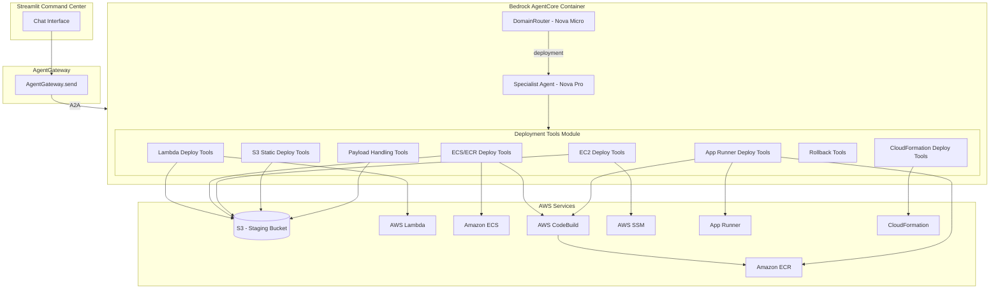

# Design Document: Code Deployment Capability

## Overview

This feature adds a `deployment` domain to the Autonomous CloudOps Command Center, enabling operators to deploy code to AWS compute targets (Lambda, ECS/ECR, EC2, App Runner, S3 static sites, CloudFormation/SAM) through the existing chat interface. The deployment domain integrates with the DomainRouter classification system and follows the established `@tool` decorator pattern from Strands SDK.

The design introduces a new `src/tools/deployment_tools.py` module containing ~20 deployment tools, a deployment plan confirmation flow leveraging the agent's conversational memory (AgentCore STM), and rollback capabilities for each supported target. All tools return structured JSON strings matching the existing tool response pattern.

### Key Design Decisions

1. **Single module, not multiple files** — All deployment tools live in one `deployment_tools.py` file, matching the existing pattern (compute_tools.py, storage_tools.py, etc.). Each file covers one domain.

2. **CodeBuild for container builds** — No local Docker. Container image builds for ECS and App Runner use AWS CodeBuild with a dynamically created buildspec, consistent with how AgentCore itself is deployed.

3. **Confirmation via agent conversation** — Deployment plans are presented as structured text in the chat. The agent uses AgentCore STM session memory to track pending confirmations. No separate approval service is needed.

4. **S3 as staging area** — All code payloads are staged to S3 before deployment. This handles the Lambda 50MB limit, provides an audit trail, and gives a consistent upload path for all targets.

5. **Rollback by version** — Each target type stores version metadata (Lambda versions, ECS task definition revisions, CloudFormation stack states) so rollbacks reference a known-good prior state.

## Architecture



### Integration Points

1. **DomainRouter** — Add `deployment` to `VALID_DOMAINS` set and update the classifier prompt to include deployment-related keywords (deploy, ship, push, release, launch code, rollback).

2. **AgentCore entrypoint** — Import deployment tools from `src/tools/deployment_tools.py`, define `TOOLS_DEPLOYMENT` list, add `"deployment"` key to `DOMAIN_TOOLS` map, and add a `"deployment"` system prompt to `DOMAIN_PROMPTS`.

3. **Cross-domain routing** — Queries like "deploy my Lambda function" route to `["deployment", "compute"]`, merging tools from both domains. This follows the existing multi-domain merge pattern.

## Components and Interfaces

### 1. Deployment Tools Module (`src/tools/deployment_tools.py`)

Each tool function uses the `@tool` decorator from Strands SDK. All tools:
- Accept explicit parameters (no dict payloads)
- Return a JSON-formatted string with structured results
- Use `boto3` clients internally
- Log operations via `structlog`
- Handle errors gracefully and return error strings (never raise)

#### Lambda Tools

| Tool | Parameters | Description |
|------|-----------|-------------|
| `deploy_lambda_function` | `code_content: str, function_name: str = '', runtime: str = 'python3.12', handler: str = 'lambda_function.lambda_handler', region: str = 'us-east-1'` | Package and deploy code to Lambda (create or update) |
| `rollback_lambda_function` | `function_name: str, target_version: str = '', region: str = 'us-east-1'` | Revert to previous published version |

#### ECS/ECR Tools

| Tool | Parameters | Description |
|------|-----------|-------------|
| `deploy_ecs_service` | `dockerfile_content: str, app_code: str, service_name: str = '', cluster_name: str = 'cloudops-cluster', region: str = 'us-east-1'` | Build image via CodeBuild, push to ECR, update ECS service |
| `rollback_ecs_service` | `service_name: str, cluster_name: str = 'cloudops-cluster', region: str = 'us-east-1'` | Revert to previous task definition revision |

#### EC2 Tools

| Tool | Parameters | Description |
|------|-----------|-------------|
| `deploy_to_ec2` | `code_content: str, instance_id: str, deploy_path: str = '', region: str = 'us-east-1'` | Upload to S3, execute SSM Run Command to pull and deploy |
| `check_ec2_ssm_status` | `instance_id: str, region: str = 'us-east-1'` | Verify SSM agent is online for target instance |

#### App Runner Tools

| Tool | Parameters | Description |
|------|-----------|-------------|
| `deploy_apprunner_service` | `dockerfile_content: str, app_code: str, service_name: str = '', region: str = 'us-east-1'` | Build and deploy to App Runner via ECR |
| `deploy_apprunner_source` | `code_content: str, runtime: str, build_command: str, start_command: str, service_name: str = '', region: str = 'us-east-1'` | Source-based App Runner deployment |

#### S3 Static Site Tools

| Tool | Parameters | Description |
|------|-----------|-------------|
| `deploy_static_site` | `files_content: str, bucket_name: str = '', enable_cloudfront: bool = False, region: str = 'us-east-1'` | Upload static files with content-type detection, configure hosting |

#### CloudFormation/SAM Tools

| Tool | Parameters | Description |
|------|-----------|-------------|
| `validate_cfn_template` | `template_content: str, region: str = 'us-east-1'` | Validate template syntax before deployment |
| `deploy_cfn_stack` | `template_content: str, stack_name: str, parameters: str = '{}', region: str = 'us-east-1'` | Create or update stack (with change set for updates) |
| `rollback_cfn_stack` | `stack_name: str, region: str = 'us-east-1'` | Rollback stack to last successful state |

#### Payload Handling Tools

| Tool | Parameters | Description |
|------|-----------|-------------|
| `prepare_code_payload` | `content: str, source_type: str = 'inline', s3_source_path: str = ''` | Extract/decode code from inline, base64, or S3 reference |
| `detect_code_language` | `code_content: str` | Detect language/framework from content |

#### Deployment Plan Tool

| Tool | Parameters | Description |
|------|-----------|-------------|
| `create_deployment_plan` | `target: str, details: str, region: str = 'us-east-1'` | Generate and present deployment plan for operator confirmation |

### 2. Domain Router Update (`src/agents/router.py`)

```python
VALID_DOMAINS = {"compute", "storage", "network", "database", "security", "ops", "deployment"}
```

Classifier prompt addition:
```
deployment - deploy code, ship, push, release, launch, rollback, update function, deploy container,
             static site, CloudFormation stack deploy, SAM deploy, code deployment, CI/CD
```

### 3. AgentCore Entrypoint Updates (`src/agentcore_entrypoint.py`)

New import block:
```python
from src.tools.deployment_tools import (
    deploy_lambda_function, rollback_lambda_function,
    deploy_ecs_service, rollback_ecs_service,
    deploy_to_ec2, check_ec2_ssm_status,
    deploy_apprunner_service, deploy_apprunner_source,
    deploy_static_site,
    validate_cfn_template, deploy_cfn_stack, rollback_cfn_stack,
    prepare_code_payload, detect_code_language,
    create_deployment_plan,
)
```

New tool group and prompt:
```python
TOOLS_DEPLOYMENT = [
    deploy_lambda_function, rollback_lambda_function,
    deploy_ecs_service, rollback_ecs_service,
    deploy_to_ec2, check_ec2_ssm_status,
    deploy_apprunner_service, deploy_apprunner_source,
    deploy_static_site,
    validate_cfn_template, deploy_cfn_stack, rollback_cfn_stack,
    prepare_code_payload, detect_code_language,
    create_deployment_plan,
    search_resource_by_name,
    describe_agent_capabilities,
]

DOMAIN_TOOLS["deployment"] = TOOLS_DEPLOYMENT
```

### 4. Deployment System Prompt

```python
DOMAIN_PROMPTS["deployment"] = (
    "You are an AWS Deployment specialist. You deploy code to Lambda, ECS/ECR, EC2 (via SSM), "
    "App Runner, S3 static sites, and CloudFormation/SAM stacks.\n\n"
    "WORKFLOW:\n"
    "1. Use prepare_code_payload to extract/validate the code.\n"
    "2. Use detect_code_language if the runtime is not explicit.\n"
    "3. Use create_deployment_plan to present the plan to the operator.\n"
    "4. WAIT for operator confirmation before executing any deployment.\n"
    "5. Execute the appropriate deploy_* tool.\n"
    "6. Return the deployment manifest with resource identifiers.\n\n"
    "RULES:\n"
    "- NEVER deploy without presenting a plan and receiving confirmation.\n"
    "- Always include the AWS account ID and region in the deployment plan.\n"
    "- For updates to existing resources, mention what will change.\n"
    "- For rollbacks, confirm which version/revision will be restored.\n"
    "- If a deployment fails, return the error and suggest corrective actions.\n"
    "- Respond in plain English with bullet points, not raw JSON.\n"
    "- When the user says 'yes', 'go ahead', 'do it', 'confirm' -- execute the deployment."
)
```

## Data Models

### Deployment Manifest (returned by all deploy tools)

```python
@dataclass
class DeploymentManifest:
    """Structured deployment result — serialized to JSON string for tool return."""
    target_type: str          # "lambda" | "ecs" | "ec2" | "apprunner" | "s3" | "cloudformation"
    status: str               # "success" | "failed" | "pending_confirmation"
    resource_arn: str         # Primary resource ARN
    region: str
    account_id: str
    timestamp: str            # ISO 8601
    details: dict             # Target-specific metadata (version, image_uri, etc.)
    error: Optional[str]      # Error message if status == "failed"
    rollback_info: Optional[dict]  # Info needed for rollback (previous version, etc.)
```

Note: This is a logical model — tools serialize this to a JSON string for return, not as a Pydantic model. This keeps deployment tools self-contained with no additional model dependencies.

### Lambda Manifest Details

```json
{
  "function_arn": "arn:aws:lambda:us-east-1:123456789012:function:my-fn",
  "version": "$LATEST",
  "runtime": "python3.12",
  "code_size_bytes": 1234,
  "code_sha256": "abc123...",
  "s3_staging_key": "deployments/lambda/my-fn/1234567890.zip"
}
```

### ECS Manifest Details

```json
{
  "ecr_image_uri": "123456789012.dkr.ecr.us-east-1.amazonaws.com/my-svc:latest",
  "task_definition_arn": "arn:aws:ecs:...:task-definition/my-svc:3",
  "service_arn": "arn:aws:ecs:...:service/cloudops-cluster/my-svc",
  "desired_count": 1,
  "codebuild_build_id": "my-project:build-id"
}
```

### EC2 Manifest Details

```json
{
  "instance_id": "i-0abc123def456",
  "s3_artifact_location": "s3://cloudops-deployments/ec2/i-0abc/1234567890.zip",
  "deployment_path": "/opt/cloudops/deployments/1234567890/",
  "ssm_command_id": "cmd-0abc123"
}
```

### App Runner Manifest Details

```json
{
  "service_arn": "arn:aws:apprunner:us-east-1:123456789012:service/my-svc/id",
  "service_url": "https://abc123.us-east-1.awsapprunner.com",
  "status": "RUNNING",
  "image_uri": "123456789012.dkr.ecr.us-east-1.amazonaws.com/my-svc:latest"
}
```

### S3 Static Site Manifest Details

```json
{
  "bucket_name": "my-static-site",
  "website_endpoint": "http://my-static-site.s3-website-us-east-1.amazonaws.com",
  "cloudfront_domain": "d1234abcdef.cloudfront.net",
  "files_uploaded": 12,
  "total_size_bytes": 45678
}
```

### CloudFormation Manifest Details

```json
{
  "stack_name": "my-stack",
  "stack_id": "arn:aws:cloudformation:us-east-1:123456789012:stack/my-stack/guid",
  "outputs": {"ApiUrl": "https://...", "TableName": "..."},
  "resources_created": 5,
  "change_set_id": "arn:aws:cloudformation:...:changeSet/my-changeset/guid"
}
```

### Deployment Plan (confirmation flow)

```json
{
  "plan_id": "deploy-plan-1234567890",
  "target_type": "lambda",
  "action": "create | update | rollback",
  "account_id": "123456789012",
  "region": "us-east-1",
  "resource_name": "cloudops-deploy-1234567890",
  "changes_summary": "Create new Lambda function with Python 3.12 runtime, 256MB memory, 30s timeout",
  "estimated_impact": "No existing resources affected",
  "requires_confirmation": true
}
```

### S3 Staging Convention

All code payloads are staged to the existing `cloudops-kb-{unique_id}` bucket (or a dedicated deployment bucket) under:

```
deployments/
├── lambda/{function_name}/{timestamp}.zip
├── ecs/{service_name}/{timestamp}/
│   ├── Dockerfile
│   └── app.zip
├── ec2/{instance_id}/{timestamp}.zip
├── apprunner/{service_name}/{timestamp}/
├── static/{bucket_name}/{timestamp}/
└── cfn/{stack_name}/{timestamp}.yaml
```

## Correctness Properties

*A property is a characteristic or behavior that should hold true across all valid executions of a system — essentially, a formal statement about what the system should do. Properties serve as the bridge between human-readable specifications and machine-verifiable correctness guarantees.*

### Property 1: Code packaging produces valid zip archive

*For any* valid code string (non-empty, containing valid UTF-8 characters), packaging it for Lambda deployment SHALL produce a byte sequence that is a valid zip archive containing at least one file with the original code content preserved.

**Validates: Requirements 1.1**

### Property 2: Default resource names match expected patterns

*For any* deployment invocation where no explicit resource name is provided, the generated name SHALL match the pattern `cloudops-deploy-\d+` for Lambda functions, and the generated path SHALL match `/opt/cloudops/deployments/\d+/` for EC2 deployments.

**Validates: Requirements 1.2, 3.2**

### Property 3: Deployment manifest completeness by target type

*For any* successful deployment to any supported target type (lambda, ecs, ec2, apprunner, s3, cloudformation), the returned manifest JSON SHALL contain all required fields for that target type: Lambda requires function_arn, version, runtime, code_size; ECS requires ecr_image_uri, task_definition_arn, service_arn, desired_count; EC2 requires instance_id, s3_artifact_location, deployment_path, ssm_command_id; App Runner requires service_arn, service_url, status; S3 requires bucket_name, website_endpoint; CloudFormation requires stack_name, stack_id, outputs, resources_created.

**Validates: Requirements 1.5, 2.4, 3.3, 4.3, 5.4, 6.4, 8.4**

### Property 4: Content-type detection for static files

*For any* file with a recognized extension (.html, .css, .js, .json, .png, .jpg, .svg, .ico, .woff, .woff2, .txt, .xml), the content-type detection function SHALL return the correct MIME type corresponding to that extension.

**Validates: Requirements 5.1**

### Property 5: Partial upload failure reporting preserves file accounting

*For any* set of files where a subset of uploads fail and the remainder succeed, the failure report SHALL correctly list all failed files and all succeeded files such that their union equals the original set and their intersection is empty.

**Validates: Requirements 5.5**

### Property 6: Deployment plan always includes account and region

*For any* invocation of the deployment plan creation, regardless of target type or parameters, the output SHALL contain a non-empty `account_id` field and a non-empty `region` field.

**Validates: Requirements 7.4**

### Property 7: Domain router classifies deployment intent

*For any* query string containing one or more deployment keywords (deploy, ship, push, release, launch code, rollback), the DomainRouter SHALL include `deployment` in its returned domain list.

**Validates: Requirements 9.1**

### Property 8: Domain router returns cross-domain pairs for combined queries

*For any* query string combining deployment intent with a specific service keyword (Lambda, ECS, EC2, S3, CloudFormation), the DomainRouter SHALL return exactly two domains: `deployment` and the corresponding service domain (compute, compute, compute, storage, ops respectively).

**Validates: Requirements 9.2**

### Property 9: Inline code payload passthrough

*For any* non-empty string passed to the payload preparation function with `source_type="inline"`, the returned code content SHALL be identical to the input string.

**Validates: Requirements 10.1**

### Property 10: Base64 payload round-trip

*For any* valid byte sequence, base64-encoding it and passing it to the payload preparation function with `source_type="base64"` SHALL produce decoded content identical to the original byte sequence.

**Validates: Requirements 10.2**

### Property 11: Language detection from code markers

*For any* code content containing a recognized language marker (Python imports like `import os`, Node.js patterns like `require(` or `const x =`, Go patterns like `package main`, Java patterns like `public class`), the language detection function SHALL return the correct language identifier.

**Validates: Requirements 10.4**

## Error Handling

### Error Categories

| Category | Trigger | Behavior |
|----------|---------|----------|
| **AWS API Error** | Any boto3 ClientError | Return error message, suggest corrective action, never raise |
| **Invalid Payload** | Empty code, unparseable base64, missing S3 object | Return descriptive error, request valid submission |
| **Resource Not Found** | Instance not SSM-managed, missing ECR repo | Explain the issue, suggest remediation (enable SSM, check ARN) |
| **Build Failure** | CodeBuild failure for ECS/App Runner | Return build logs, phase that failed, and error message |
| **Stack Failure** | CloudFormation CREATE_FAILED or UPDATE_FAILED | Return failed stack events, offer rollback |
| **Size Limit** | Lambda zip > 50MB | Automatically route through S3 staging (transparent to operator) |
| **Rate Limiting** | AWS throttling | Retry with exponential backoff (3 retries), then report |
| **Timeout** | Long-running operations (CodeBuild, CFN) | Poll with configurable intervals, report progress, timeout after 30 minutes |

### Error Response Format

All tools return errors as structured JSON strings (never raise exceptions):

```json
{
  "status": "failed",
  "error_type": "aws_api_error",
  "error_message": "Function not found: arn:aws:lambda:...",
  "aws_error_code": "ResourceNotFoundException",
  "suggestion": "Verify the function name exists in us-east-1. Use list_lambda_functions to check.",
  "target_type": "lambda",
  "timestamp": "2024-01-15T10:30:00Z"
}
```

### Retry Strategy

- **Idempotent operations** (S3 upload, Lambda update): Retry up to 3 times with exponential backoff (1s, 2s, 4s)
- **Non-idempotent operations** (stack creation, service creation): No automatic retry; report failure and let operator decide
- **Long-running operations** (CodeBuild, CloudFormation): Poll every 10 seconds, report status every 30 seconds, hard timeout at 30 minutes

## Testing Strategy

### Approach

The deployment tools module is well-suited for property-based testing because:
- Payload handling functions are pure transformations (zip, base64, content-type mapping)
- Manifest construction follows structural rules that hold across all inputs
- Router classification is deterministic logic over text patterns
- Default name/path generation follows universal patterns

### Property-Based Testing

**Library**: [Hypothesis](https://hypothesis.readthedocs.io/) (Python PBT library, already compatible with pytest)

**Configuration**:
- Minimum 100 examples per property test
- Use `@settings(max_examples=200)` for critical properties
- Tag format: `# Feature: code-deployment-capability, Property {N}: {title}`

**Test file**: `tests/test_deployment_tools_properties.py`

Each correctness property maps to a single Hypothesis test:

| Property | Test Function | Generators |
|----------|--------------|------------|
| 1: Zip packaging | `test_packaging_produces_valid_zip` | `st.text(min_size=1)` for code content |
| 2: Default names | `test_default_names_match_pattern` | `st.just("")` for empty name input |
| 3: Manifest completeness | `test_manifest_completeness_by_target` | `st.sampled_from(["lambda", "ecs", "ec2", ...])` |
| 4: Content-type detection | `test_content_type_detection` | `st.sampled_from(KNOWN_EXTENSIONS)` |
| 5: Partial failure accounting | `test_partial_failure_partitions_files` | `st.lists(st.text())` for file lists |
| 6: Plan has account/region | `test_plan_always_has_account_region` | `st.sampled_from(TARGET_TYPES)` |
| 7: Router deployment intent | `test_router_classifies_deployment` | `st.sampled_from(DEPLOYMENT_KEYWORDS)` combined with `st.text()` |
| 8: Router cross-domain | `test_router_cross_domain_pairs` | `st.tuples(keyword, service_word)` |
| 9: Inline passthrough | `test_inline_payload_passthrough` | `st.text(min_size=1)` |
| 10: Base64 round-trip | `test_base64_round_trip` | `st.binary(min_size=1)` |
| 11: Language detection | `test_language_detection_markers` | `st.sampled_from(LANGUAGE_MARKERS)` |

### Unit Tests (Example-Based)

**Test file**: `tests/test_deployment_tools.py`

| Test | What It Verifies |
|------|-----------------|
| `test_lambda_create_new_function` | Correct create_function call with defaults (256MB, 30s) |
| `test_lambda_update_existing_function` | Calls update_function_code when function exists |
| `test_lambda_deploy_failure_returns_error` | Error message included on failure |
| `test_ecs_creates_ecr_repo_if_missing` | ECR create_repository called when needed |
| `test_ecs_update_existing_service` | Registers new task def, updates service |
| `test_ec2_ssm_not_available` | Reports SSM unavailability clearly |
| `test_apprunner_source_deployment` | Correct source configuration |
| `test_cfn_validates_before_deploy` | Validation precedes stack operation |
| `test_cfn_change_set_for_existing_stack` | Change set created for updates |
| `test_s3_bucket_creation_with_hosting` | Creates bucket with website config |
| `test_rollback_lambda_previous_version` | Reverts to prior version |
| `test_rollback_ecs_previous_revision` | Updates to previous task def |
| `test_rollback_no_previous_version` | Informs user, suggests alternatives |

### Integration Tests

**Test file**: `tests/test_deployment_integration.py`

- Full deployment workflow with mocked AWS clients (end-to-end tool chain)
- Router → deployment domain classification
- Deployment plan → confirmation → execution flow
- Cross-domain tool merging (deployment + compute)

### Test Infrastructure

- All AWS calls mocked via `unittest.mock.patch` (no real AWS in tests)
- Shared fixtures in `tests/conftest.py` for deployment-specific mocks
- CodeBuild mocked with pre-built success/failure responses
- Use `moto` library for higher-fidelity S3 and Lambda mocking where needed

