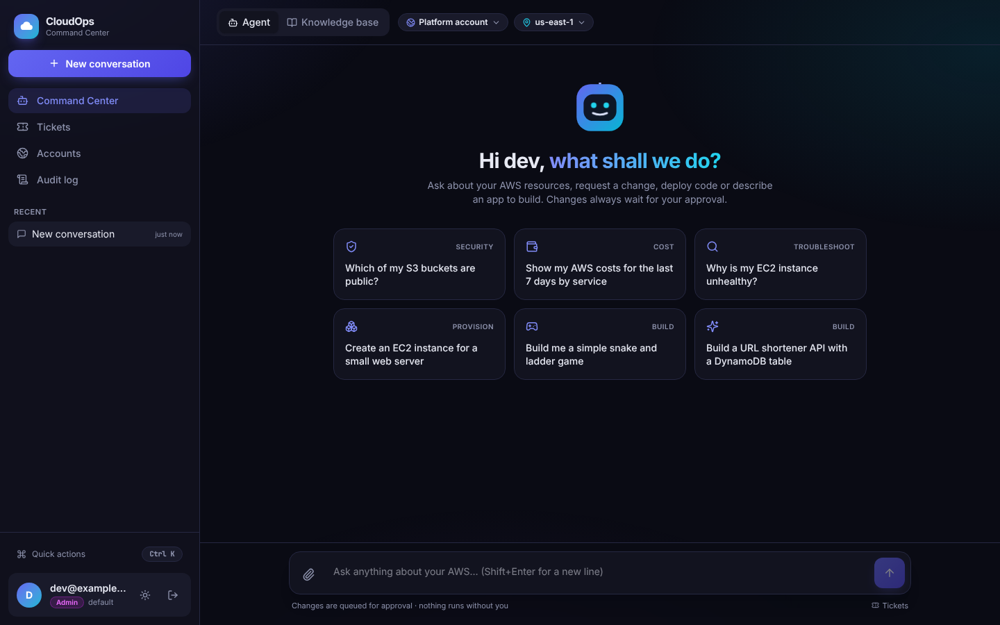
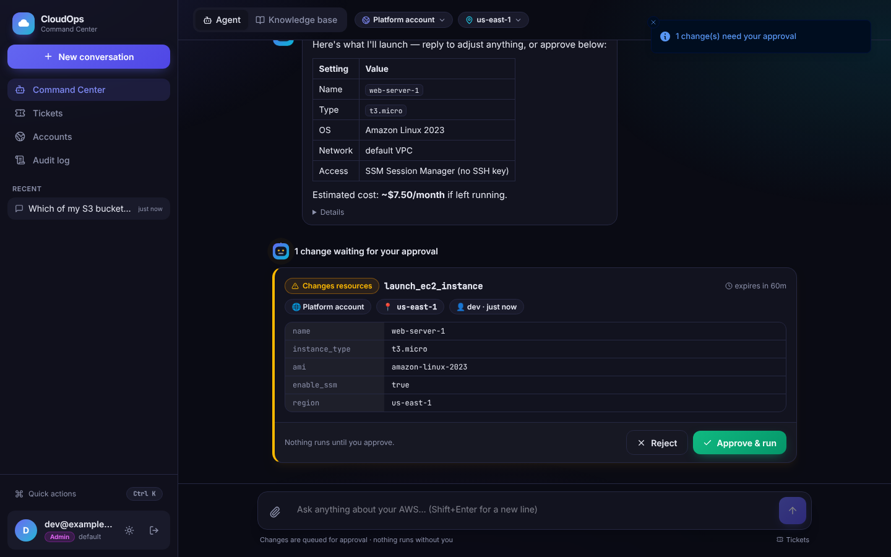
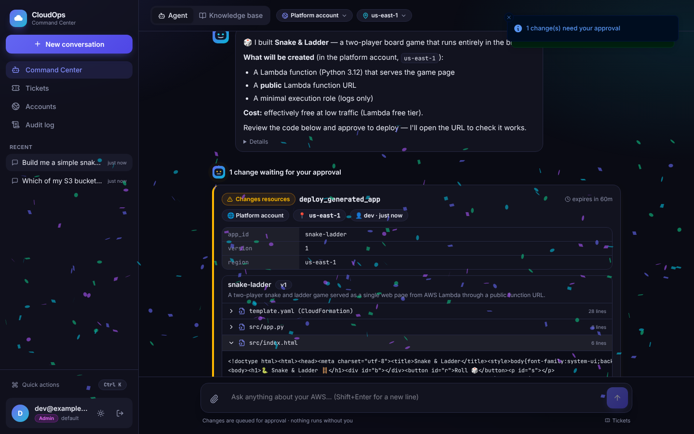
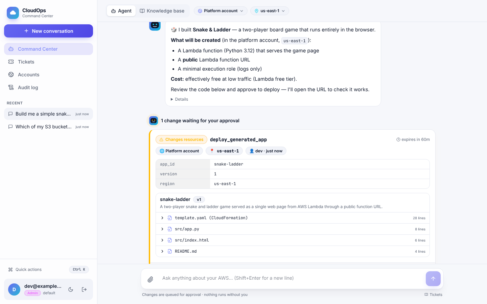

# CloudOps Command Center

Chat with an AI agent that inspects and operates your AWS accounts. It can
investigate across 285 AWS tools, deploy code you upload as a zip (Lambda, EC2,
ECS Fargate, S3 websites), and work across many accounts. **Every change it
proposes waits for a person to approve the exact call before anything runs.**


## Features

- **Agent for AWS operations.** Bedrock AgentCore runs a Strands agent: Nova
  Micro routes each request to the right tool domains, and Nova Pro reasons over
  them. Ask "which S3 buckets are public?" or "why is i-0abc… unhealthy?".
- **Enforced human approval.** Mutating tool calls are intercepted in code and
  queued with their exact arguments, target account and region. Approving runs
  that stored call exactly once, with no LLM involved. Requests can be required
  to come from a different person than the approver.
- **Cross-account.** Pick target accounts in the console. The agent assumes
  `CloudOpsCrossAccountRole` (with an ExternalId) in each registered account,
  fans out, and reports per account.
- **Deploy uploaded code.** Upload a zip and choose Lambda, an existing or new
  EC2 instance, ECS Fargate, or an S3 static site. The agent inspects it, plans,
  and queues the deployment for approval.
- **Builds whole applications.** Describe an app ("a URL shortener API with a database") and
  the agent writes the code and the CloudFormation for it. You review every file on the approval
  card; one approval deploys it to the chosen account and smoke-tests the live URL. Ask for
  changes and it ships a new version.
- **Learns from people.** Requests the agent can't handle become tickets.
  Resolutions feed a tenant-filtered Bedrock knowledge base every hour.
- **A console that's a pleasure to use.** A fast React app with dark and light themes, an
  animated agent that shows what it's doing, suggested prompts, rich approval cards with a
  code viewer for generated apps, drag-and-drop uploads, a Ctrl+K command palette, and a
  little confetti when a change lands.
- **Production foundations.** Cognito sign-in with role groups and MFA;
  CloudFront, WAF and a private ECS console; an audit log of every action;
  CloudWatch alarms and a dashboard; everything defined in CloudFormation and
  deployed with one command.

## Screenshots

| Command Center | Approving a change |
|---|---|
|  |  |
| **Reviewing a generated app** | **Light theme** |
|  |  |

## Deploy

```bash
pip install -r requirements/dev.txt
```

```bash
python scripts/deploy.py --region us-east-1 --admin-email you@example.com
```

**[docs/DEPLOYMENT.md](docs/DEPLOYMENT.md)** is the step-by-step guide. It
covers prerequisites, Bedrock model access, users and roles, connecting other
accounts (single accounts or an organization-wide StackSet), custom domains,
monitoring, updating, teardown and troubleshooting.

## Documentation

| Document | Contents |
|---|---|
| [docs/DEPLOYMENT.md](docs/DEPLOYMENT.md) | Deploying into your account, step by step |
| [docs/ARCHITECTURE.md](docs/ARCHITECTURE.md) | Components, agent pattern, approval flow, cross-account model, data model, design decisions |
| [AGENT_CAPABILITIES.md](AGENT_CAPABILITIES.md) | Example requests for every tool domain |

## Repository layout

```
agent_main.py              AgentCore entry point (imports src/agentcore_entrypoint.py)
config.py                  All settings, read from environment variables
src/
  agentcore_entrypoint.py  Agent: routing, per-account runs, chat/execute/check_account modes
  agents/router.py         Nova Micro domain router
  agents/gateway.py        Console → agent client (+ knowledge-base fallback)
  core/approvals.py        Approval gate and exactly-once execution of approved actions
  core/accounts.py         Managed-account registry (allow-list)
  core/aws_clients.py      Account-aware boto3 (assume role + ExternalId, per-request context)
  core/security.py         Roles, permissions, audit log
  core/usage.py            Per-tenant daily request metering
  core/monitoring.py       JSON logging and CloudWatch EMF metrics
  services/                Tickets, knowledge-base retrieval, code-upload staging
  jobs/learning_loop.py    Hourly knowledge-base sync
  tools/                   285 AWS tools in seven domains (+ uploaded-zip deployment)
console/                   Console API server (FastAPI: Cognito sign-in, JSON API, background jobs)
web/                       Console web app (React + TypeScript + Tailwind, built into the image)
infra/                     CloudFormation: foundation.yaml, app.yaml, cross_account_role.yaml
scripts/                   deploy.py, destroy.py
docs/                      Guides and the architecture diagram source
tests/                     pytest suite (moto; no real AWS calls)
```

## Development

```bash
pip install -r requirements/dev.txt
```

```bash
pytest -q
```

```bash
cfn-lint infra/*.yaml
```

To run everything locally, see [Local development](docs/DEPLOYMENT.md#local-development).
