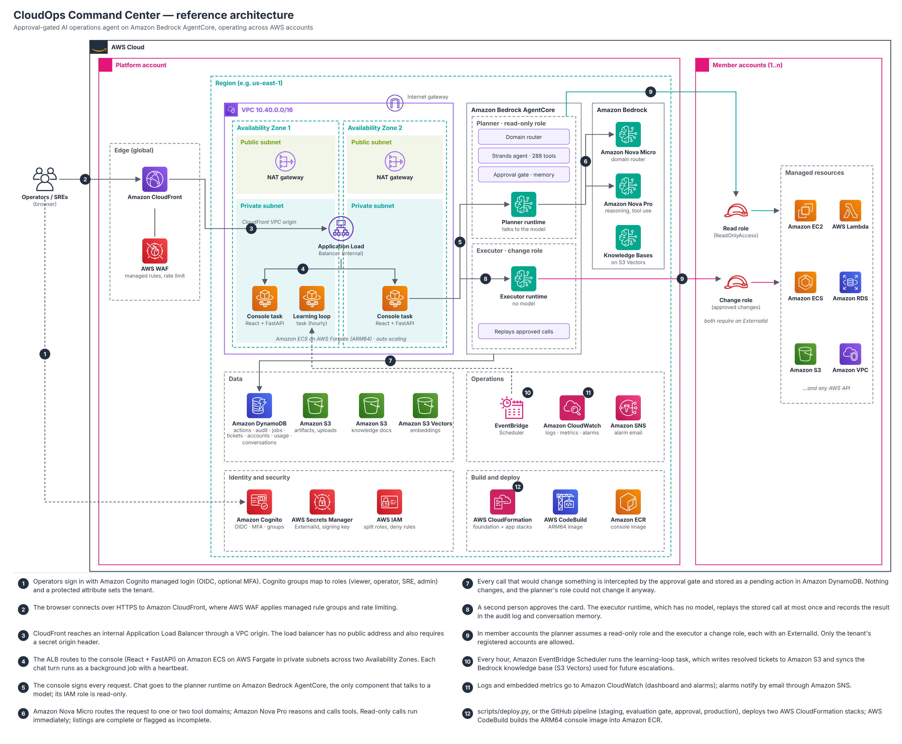
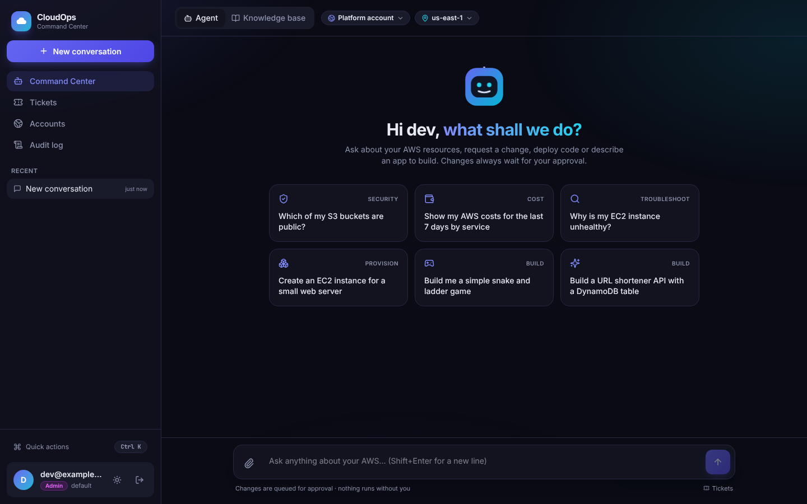
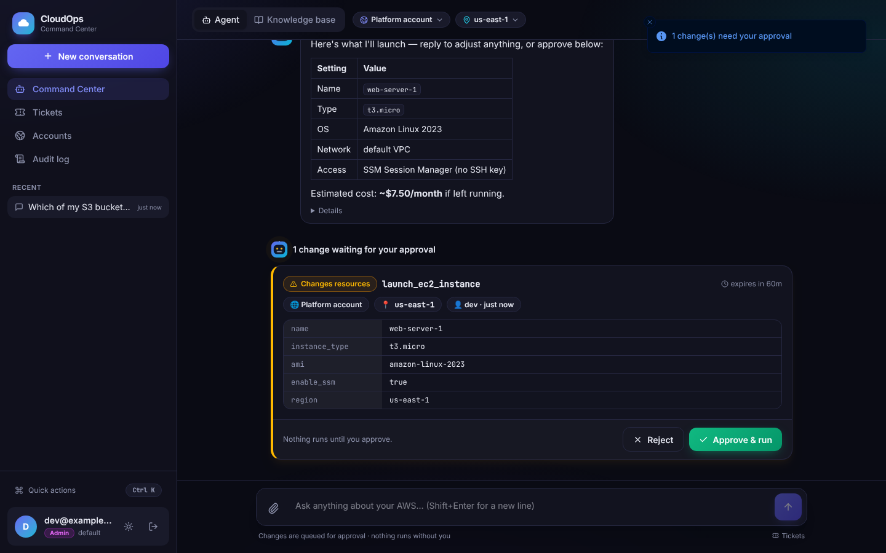
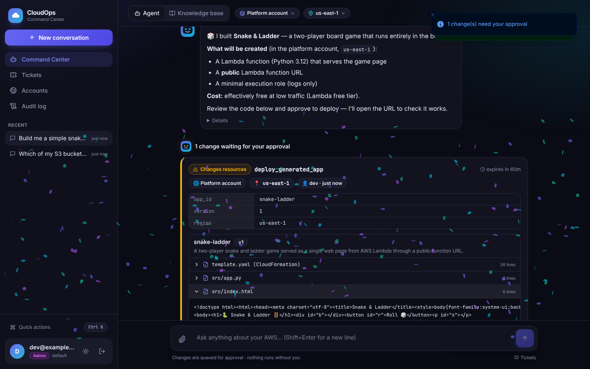
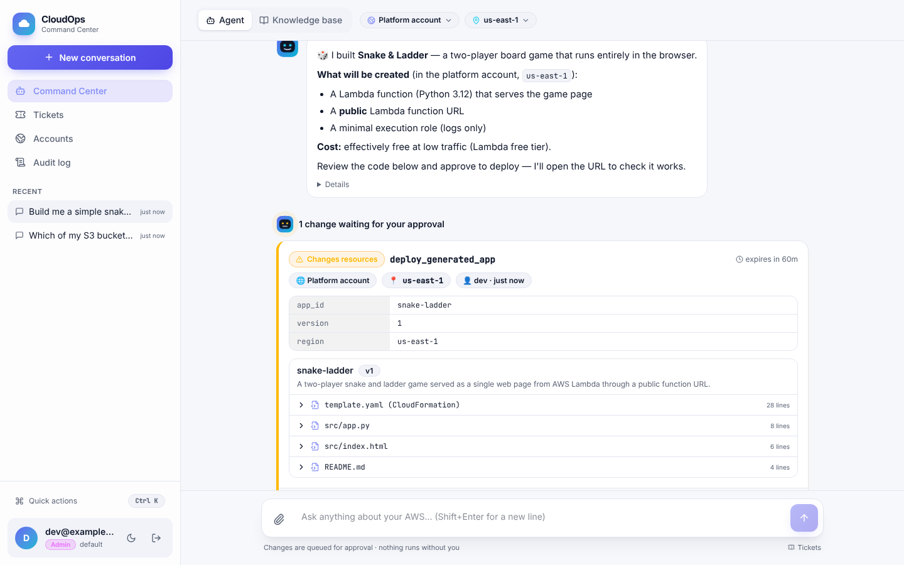

# CloudOps Command Center

Chat with an AI agent that inspects and operates your AWS accounts. It can
investigate across 285 AWS tools, deploy code you upload as a zip (Lambda, EC2,
ECS Fargate, S3 websites), and work across many accounts. **Every change it
proposes waits for a person to approve the exact call before anything runs.**



## Features

- **Agent for AWS operations.** Bedrock AgentCore runs a Strands agent: Nova
  Micro routes each request to the right tool domains, and Nova Pro reasons over
  them. Ask "which S3 buckets are public?" or "why is i-0abc… unhealthy?".
- **The model has no write access.** The agent is two runtimes. The planner
  talks to the model with read-only credentials and can only queue proposals.
  The executor has no model and runs a stored call only after a person approves
  it, at most once, with its exact arguments, account and region. By default a
  second person must approve.
- **The platform protects itself.** Requests to the agent are signed by the
  console, and the executor is denied access to the platform's own users, audit
  trail, account allow-list, secrets and runtimes.
- **Cross-account.** Name any registered account in your message or pick defaults in the
  console. One agent run works across accounts, assuming a per-account role (with an
  ExternalId) per tool call, so it can compare accounts or prepare changes that span them, like
  VPC peering (one approval: request, accept and routes in both accounts).
- **Deploy uploaded code.** Upload a zip and choose Lambda, an existing or new
  EC2 instance, ECS Fargate, or an S3 static site. The agent inspects it, plans,
  and queues the deployment for approval.
- **Builds small applications.** Describe an app ("a snake and ladder game", "a todo list my
  team can share") and the platform picks a tested blueprint, has the model write the page and
  a small Python file as plain text, checks the result and gets problems fixed. You review every
  file on the approval card; one approval deploys it and smoke-tests the live URL. Ask for
  changes and it ships a new version. Designed to work on Amazon Nova Pro.
- **Learns from people.** Requests the agent can't handle become tickets.
  Resolutions feed a tenant-filtered Bedrock knowledge base every hour.
- **A console that's a pleasure to use.** A fast React app with dark and light themes, an
  animated agent that shows what it's doing, suggested prompts, rich approval cards with a
  code viewer for generated apps, drag-and-drop uploads, a Ctrl+K command palette, and a
  little confetti when a change lands.
- **Operational foundations.** Cognito sign-in with role groups and MFA;
  CloudFront, WAF and a private load balancer and console; an audit log of every
  action; CloudWatch alarms and a dashboard; everything defined in CloudFormation
  and deployed with one command or from a GitHub pipeline with a staging
  environment and an evaluation gate.

## Status

What is verified on every commit: the safety guarantees (see
[docs/EVALUATION.md](docs/EVALUATION.md)), 305 tests at 71% coverage of the application
code, a smoke run of all 285 tools against simulated AWS, lint with security rules, type
checks on the core, dependency audits and template validation.

What is not: how often the model picks the right tool has **not** been measured with real
models yet (run `python evals/run_evals.py --region us-east-1 --repeat 3`), and the
planner/executor split, the private load balancer and the signed requests have been tested
against simulated AWS but not yet deployed to a live account. Treat a first deployment as a
staging exercise. [Known limits](docs/ARCHITECTURE.md#known-limits) lists the rest.

## Screenshots

| Command Center | Approving a change |
|---|---|
|  |  |
| **Reviewing a generated app** | **Light theme** |
|  |  |

## Deploy

```bash
pip install -r requirements/dev.txt
```

```bash
python scripts/deploy.py --region us-east-1 --admin-email you@example.com
```

**[docs/DEPLOYMENT.md](docs/DEPLOYMENT.md)** is the step-by-step guide. It
covers prerequisites, Bedrock model access, users and roles, connecting other
accounts (single accounts or an organization-wide StackSet), custom domains,
monitoring, updating, teardown and troubleshooting.

## Documentation

| Document | Contents |
|---|---|
| [docs/DEPLOYMENT.md](docs/DEPLOYMENT.md) | Deploying into your account, step by step |
| [docs/BLOG.md](docs/BLOG.md) | The story: what it does, the agentic pattern, why each component exists, how it's evaluated, what is and isn't proven |
| [docs/ARCHITECTURE.md](docs/ARCHITECTURE.md) | Components, trust boundaries, agent pattern, approval flow, cross-account model, data model, design decisions, known limits |
| [docs/EVALUATION.md](docs/EVALUATION.md) | Safety guarantees, the scenario evaluation and its metrics, production signals |
| [AGENT_CAPABILITIES.md](AGENT_CAPABILITIES.md) | Example requests for every tool domain |

## Repository layout

```
agent_main.py              AgentCore entry point (imports src/agentcore_entrypoint.py)
config.py                  All settings, read from environment variables
src/
  agentcore_entrypoint.py  Agent: planner (chat) and executor (approved actions) modes
  agents/router.py         Nova Micro domain router
  agents/gateway.py        Console → agent client (+ knowledge-base fallback)
  core/approvals.py        Approval gate; at-most-once execution of approved actions
  core/proposal_checks.py  Refuses proposals known to fail or aimed at the platform itself
  core/identity.py         Signed requests between the console and the agent
  core/accounts.py         Per-tenant managed-account registry (allow-list)
  core/tenancy.py          What each tenant may reach; per-tenant ExternalId
  core/conversations.py    Conversation memory (turns, tool results, execution results)
  core/aws_clients.py      Account-aware boto3 (assume role + ExternalId) with complete listings
  core/security.py         Roles, permissions, audit log
  core/usage.py            Per-tenant daily request metering
  core/monitoring.py       JSON logging and CloudWatch EMF metrics
  services/                Tickets, knowledge-base retrieval, code-upload staging
  jobs/learning_loop.py    Hourly knowledge-base sync
  tools/                   285 AWS tools in eight domains (+ uploaded-zip deployment)
console/                   Console API server (FastAPI: Cognito sign-in, JSON API, background jobs)
web/                       Console web app (React + TypeScript + Tailwind, built into the image)
infra/                     CloudFormation: foundation.yaml, app.yaml, cross_account_role.yaml, github_oidc_role.yaml
scripts/                   deploy.py, destroy.py
evals/                     Agent evaluation: scenarios + harness (real models, stubbed AWS)
docs/                      Guides, blog, evaluation, and the architecture diagram source
tests/                     pytest suite (moto; no real AWS calls)
```

## Development

```bash
pip install -r requirements/dev.txt
```

```bash
pytest -q
```

```bash
cfn-lint infra/*.yaml
```

```bash
python evals/run_evals.py --offline
```

```bash
ruff check . && mypy src/core console src/agents src/services src/jobs src/appbuilder config.py
```

To run everything locally, see [Local development](docs/DEPLOYMENT.md#local-development).
The AWS SDK is kept current by a weekly workflow (`.github/workflows/update-aws-sdk.yml`) and
other dependencies by Dependabot; see [Updating](docs/DEPLOYMENT.md#updating).
