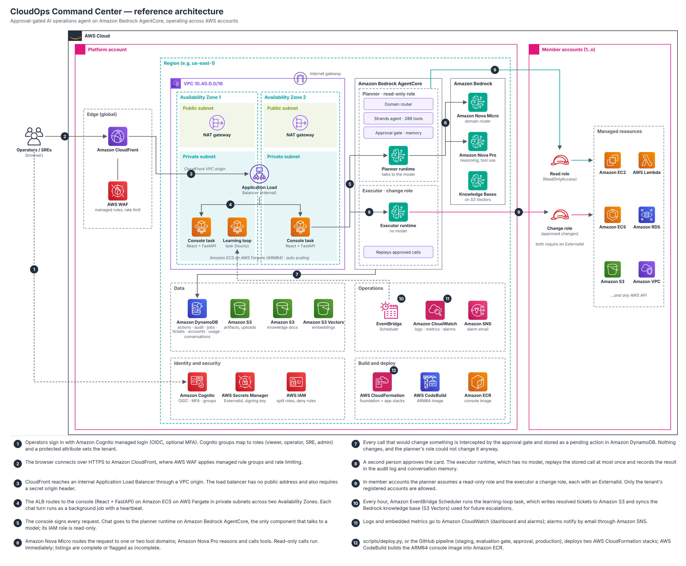
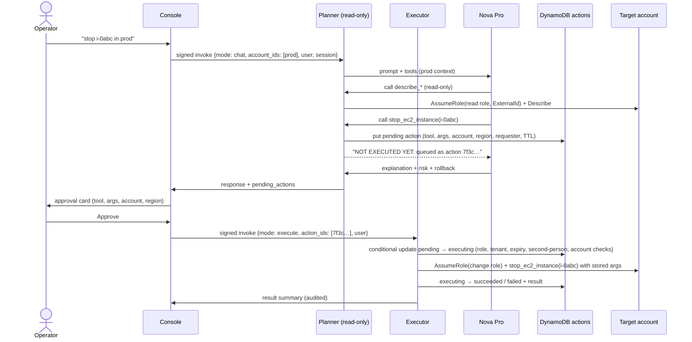

# Architecture



For a narrative walkthrough of why each part exists, see [BLOG.md](BLOG.md); for how the agent is
measured, see [EVALUATION.md](EVALUATION.md).

The diagram uses the official AWS Architecture Icons and the standard AWS group styles
(AWS Cloud, account, Region, VPC, Availability Zone, subnets), with numbered steps explained
in its legend. It's generated from [`architecture.py`](architecture.py) as
[`architecture.svg`](architecture.svg) (scalable, for slides and docs) and `architecture.png`.
Regenerate both with `python docs/architecture.py` (needs the dev requirements and
`playwright install chromium` for the PNG).

## Components

| Component | Runs on | Code | Responsibility |
|---|---|---|---|
| Console | ECS Fargate behind ALB + CloudFront | `console/` (FastAPI), `web/` (React) | Sign-in (Cognito OIDC, signed session cookie), chat, account and region targeting, code upload, approval cards, tickets, account registry, audit log |
| Gateway | Inside the console process | `src/agents/gateway.py` | Signs each request and sends chat to the planner and approvals to the executor (`InvokeAgentRuntime`); falls back to the knowledge base when the agent escalates; rejects actions and lists pending ones |
| Planner | Bedrock AgentCore Runtime `<app>_planner`, **read-only role** | `agent_main.py`, `src/agentcore_entrypoint.py` (`RUNTIME_MODE=planner`) | The only component that talks to a model. Routes each prompt to 1–2 tool domains, runs one Strands agent that reads across accounts, and queues proposed changes. Its role cannot change any resource |
| Executor | Bedrock AgentCore Runtime `<app>_agent`, change role | same package (`RUNTIME_MODE=executor`) | Runs approved actions exactly as recorded. No model, no chat. The only component with credentials that can change things, and it is denied access to the platform's own resources |
| Domain router | Inside the planner | `src/agents/router.py` | One Nova Micro call classifies the prompt into domains (compute, storage, network, database, security, ops, deployment, build) |
| Tools | Both runtimes | `src/tools/` | 285 boto3 tools (183 read-only, 102 that change things). Clients come from `src/core/aws_clients.py`, which makes them account-aware and makes list calls return every page. Every domain also has `list_aws_operations` and `describe_aws_operation` (exact current operation names and parameters from the installed SDK), `query_aws_api` (metadata reads only; data-plane and secret-returning operations refused, secrets redacted; not given to viewers) and `call_aws_api` (any other operation, always approval-gated) |
| Approval engine | Planner queues, executor runs | `src/core/approvals.py`, `src/core/proposal_checks.py` | Intercepts mutating tool calls, refuses ones known to fail or aimed at the platform itself, stores the rest, and executes approved ones at most once |
| Identity | Console signs, runtimes verify | `src/core/identity.py` | HMAC signature over every request, so the role and tenant in it can't be forged by something that merely has permission to invoke a runtime |
| Account registry | DynamoDB `accounts` | `src/core/accounts.py`, `src/core/tenancy.py` | Per-tenant allow-list of accounts; per-tenant ExternalId |
| Conversation memory | DynamoDB `conversations` | `src/core/conversations.py` | Each turn with its tool results and proposals, plus what approved actions returned |
| Learning loop | Scheduled ECS task (hourly) | `src/jobs/learning_loop.py` | Writes resolved tickets, with tenant metadata, to the knowledge bucket and starts ingestion |
| Knowledge base | Bedrock KB on S3 Vectors | `src/services/rag_service.py` | Tenant-filtered retrieval over past resolutions |

## Trust boundaries

The design assumes the model can be wrong or manipulated (through a prompt, a ticket, a tool
result or an uploaded file) and that code can have bugs. Each boundary is enforced by something
other than the model's good behaviour:

| Boundary | Enforced by |
|---|---|
| The model cannot change anything | The planner's IAM role is `ReadOnlyAccess`; in managed accounts it can only assume the read-only `CloudOpsCrossAccountReadRole`. The approval gate (a hook in the planner) is the first line; IAM is the backstop if the hook or a tool were ever wrong |
| Only approved calls change things | The executor accepts only `execute` requests, loads the stored call, and has no model. The planner cannot invoke it |
| Requests carry a real identity | The console signs the whole request (user, role, tenant, action ids, timestamp) with a key from Secrets Manager; runtimes reject unsigned, altered or stale requests and fail closed if the key is missing |
| An approval can't be turned against the platform | IAM denies on the executor cover the user pool, audit trail, account allow-list, approvals table (state changes only), secrets, runtimes, stacks, roles, console service, images and buckets. Proposals naming those resources are also refused before queueing |
| Tenants are separate | Accounts belong to one tenant; each tenant presents its own ExternalId; only platform tenants reach the platform account; records are keyed by tenant; the planner is denied reads of the platform's own tables, users, logs and files |
| Reads don't leak data or have side effects | `query_aws_api` accepts metadata operations only and redacts secret-looking values; viewers don't get it |
| The console can't be opened by misconfiguration | Sign-in defaults to Cognito and the server refuses to start without complete settings |

## Agent pattern

The agent follows a **router → specialist → gated tools** pattern.

1. **Route.** Nova Micro picks 1–2 of eight domains (compute, storage, network, database,
   security, ops, deployment, build), so the model sees about 30–65 tool schemas instead of 285. An attached code upload always adds
   `deployment`. If the reply shows a needed tool was missing, the agent retries
   once with one extra domain.
2. **Reason.** A Strands `Agent` (Nova Pro) runs with the merged tools, a
   domain prompt, and context notes. These cover the target account, the
   selected region, any uploaded artifact, and read-only mode for viewers.
3. **Act through a gate.** Read-only tools (names starting with `list_`,
   `analyze_`, `get_`, `describe_`, `check_`, `inspect_`, `search_`, `detect_`,
   `validate_`, `lookup_`, or `prepare_`) run immediately. Any other tool call
   is intercepted by `ApprovalGate`, a Strands `BeforeToolCallEvent` hook. The
   hook records the call as a pending action and cancels it, and the model is
   told the call was queued, not that it ran. Before queueing, `proposal_checks` refuses calls
   known to fail (with the fix) and calls that name the platform's own resources.
4. **Work across accounts in one run.** Every tool the agent sees is wrapped by
   `AccountScopedTool` (`src/core/account_scope.py`), which adds an optional `account` argument
   (`platform`, or a registered account's name or id). Each call runs inside `use_account(...)`,
   so every boto3 client it creates uses that account's assumed-role credentials. The system
   prompt lists the platform and registered accounts by name; the console's picker sets the
   default for calls that omit `account`. One turn can therefore compare accounts or prepare a
   change that spans them, such as peering a VPC in one account with a VPC in another. The approval gate records each queued call's own account, and the prompt forbids
   stating anything about an account that wasn't queried in that turn.
5. **Remember facts, not chat text.** Each turn is recorded with the tools it ran, their
   (redacted) results and its proposals; the executor records what approved actions returned.
   The next turn's prompt is built from those records (`src/core/conversations.py`), so "peer
   the two VPCs you just created" uses the real ids. The browser's copy of the conversation
   is only a fallback when no record exists.
6. **Say when a list is incomplete.** AWS clients follow pagination automatically, up to a cap
   of 25 pages. If the cap cuts a listing short, the tool result tells the model so.

### Approval flow



Why it is safe:
- **The model has no write access.** Planning and execution are separate runtimes with
  separate roles; a bypassed hook or a mislabelled tool still can't change anything.
- **No LLM in the execution step.** The stored call is replayed exactly as it was recorded.
- **Runs at most once.** A DynamoDB conditional write moves each action from `pending` to
  `executing`. If the executor stops mid-run, the action is marked `interrupted` after
  `EXECUTION_TIMEOUT_SECONDS` and is never retried, because the change may or may not have
  happened; the operator is told to check before proposing it again. Approvals expire after
  `ACTION_TTL_SECONDS` (one hour).
- **Checks on the approver.** The approver's role must be operator, SRE or admin, and their
  tenant must match. By default a different person must approve than the one who asked
  (`REQUIRE_SEPARATE_APPROVER`; `--allow-self-approval` turns this off for single-user setups).
- **The account is re-checked at execution.** An account removed from the tenant's allow-list
  after the proposal can no longer be changed.
- **Fails closed.** If the queue write fails, the tool still does not run.
- **Prompt injection can't bypass it.** Instructions hidden in tool output can at most get a
  change *queued*, never executed.

### Jobs and recovery

Agent turns and approvals run as background jobs in the console task that accepted them, with
state in DynamoDB so any task can answer the browser's poll. While a job runs, its task
refreshes a heartbeat. If that task is replaced or crashes, the heartbeat goes stale and the
next poll settles the job: a lost approval reports what the executor actually did (read from
the actions table, since the executor carries on without the console); any other job fails
with a message asking the user to resend. Nothing waits forever and nothing is re-run.

## App builder

"Build me a snake and ladder game" is routed to the `build` domain and handled by a pipeline
(`src/appbuilder/`), not by the tool-calling agent. Tool calls carry their arguments as JSON,
and a mid-sized model asked to put several hundred lines of code inside a JSON string often
produces a malformed call. So the model is given small, separate jobs and never writes
infrastructure:

1. **Plan.** One short JSON answer: build, change or delete; a name; which blueprint; a
   specification. If the answer is unusable, the platform falls back to sensible defaults.
2. **Write.** One model call per file, answered as plain text in a code block. Output cut off
   by the token limit is continued automatically.
3. **Check.** Static checks, with nothing executed: Python syntax, only standard-library and
   boto3 imports, the required entry function, complete HTML, no references to files that don't
   exist, no placeholders, and a heuristic scan of inline JavaScript for cut-off code.
4. **Repair.** Problems go back to the model with the file, up to two times. If blocking
   problems remain, the app is **not** stored and nothing is offered for approval.
5. **Store.** The files, the platform's entry point and the blueprint's template become an
   immutable version under `s3://<artifacts>/apps/<tenant>/<app_id>/v<N>/`.
6. **Queue.** `deploy_generated_app(app_id, version)` goes through the approval gate. The card
   shows every file and the template from the stored version, so what you review is what ships.

| Blueprint | The model writes | The platform provides |
|---|---|---|
| `static-site` | `static/index.html` (one self-contained page) | A Lambda function with a public URL serving the page |
| `web-app` | `api.py` (`handle(method, path, query, body, store)`), then `static/index.html` written against it | The same, plus API dispatch and, if the code stores data, a DynamoDB table |
| `scheduled-job` | `job.py` (`run(store)`) | A Lambda function on an EventBridge schedule, plus a table if needed |

Every generated app ships the same entry point (`src/appbuilder/runtime_handler.py`, packaged
as `handler.py`). It serves files under `static/` (and nothing outside it), dispatches `/api/*`
to the app's `handle`, returns the app's own errors as JSON, and gives the app a `store` with
`put`, `get`, `list` and `delete`, so generated code never touches DynamoDB types or table
design.

**No IAM in generated stacks.** Every app runs as one pre-created role,
`cloudops-generated-app`, which can only write logs and use DynamoDB tables named
`cloudops-gen-*`. The app stack creates it in the platform account and the cross-account
template creates it in managed accounts. Generated code can therefore never be granted more
than that, and deploying needs no permission to create roles. The trade-off is that apps in
one account share the role, so one generated app could read another's table.

On approval, the executor copies the code zip to the target account's staging bucket, creates or
updates the stack `cloudops-gen-<app_id>`, and calls every URL output as a smoke test. Asking
for a change loads the current files, rewrites them with the same pipeline and queues a new
version; `delete_generated_app` (also gated) removes the stack.

**Limits.** One page and one short Python file per app; standard library and boto3 only; no
sign-in (URLs are public), email, file uploads or third-party services; storage is the `store`
only. How often the model produces an app that passes its checks is measured by the build
scenarios in the evaluation, and has not been measured yet.

## Cross-account access

```
Planner role (platform account, ReadOnlyAccess)
   └── sts:AssumeRole + ExternalId ──► CloudOpsCrossAccountReadRole (each managed account)
                                          ReadOnlyAccess
Executor role (platform account)
   └── sts:AssumeRole + ExternalId ──► CloudOpsCrossAccountRole (each managed account)
                                          PowerUserAccess + scoped IAM, or ReadOnlyAccess
```

- Accounts are registered per tenant, and an account belongs to exactly one tenant. Tenants
  other than the default one present their own ExternalId (derived from the platform's secret
  and the tenant id), so a role set up for one tenant can't be used by another. Only tenants
  listed in `PLATFORM_TENANTS` may use the platform account itself.
- The console's picker sends the operator's default account(s) on every turn, so follow-ups stay
  in the right place; accounts can also be named in the message ("compare prod and staging") and
  the agent passes them per tool call. Conversation history is never scanned for account ids.
- Independent changes across accounts appear as numbered approval cards; **Approve all in order**
  runs them top to bottom and stops at the first failure, leaving later steps pending. Approved
  steps can't pass outputs to each other, so when a step needs an id that only an earlier step
  produces, the agent queues the earlier step alone and proposes the next one once it has run.
- Workflows whose steps must happen together are single tools. `create_vpc_peering` is one
  approval that checks both VPCs in their own accounts, refuses overlapping CIDRs, requests the
  peering from the requester account (with the peer's owner id and region), accepts it from the
  accepter account, waits for `active`, and adds routes for the peer CIDR on both sides.
- Before a call is queued, `src/core/proposal_checks.py` refuses proposals that are known to fail,
  and tells the model what to do instead. Peering through `call_aws_api` is redirected to
  `create_vpc_peering`, and a VPC whose CIDR overlaps another VPC proposed in the same request is
  refused, with a free range suggested. Refused calls never become approval cards.
- Only the tenant's registered accounts (plus the platform account, for platform tenants) are
  used. Anything else is refused, with a message explaining how to register it. The allow-list
  is checked again when an approved action executes.
- Assumed-role credentials are cached per account until 5 minutes before they
  expire.
- Uploaded code stays in the platform account's artifact bucket. The deploy
  tools read it with platform credentials, then create resources with the
  target account's credentials. EC2 instances download it through a one-hour
  presigned URL, so no cross-account bucket policy is needed.

## Data model

| Table | Key | Indexes / TTL | Contents |
|---|---|---|---|
| `<app>-actions` | `action_id` | GSI `by-session` (session_id); TTL `expires_at` | Pending, executing, succeeded, failed, interrupted and rejected actions with tool, args, account, region, requester, approver, result |
| `<app>-audit` | `tenant_id`, `sk` = `<iso time>#<id>` | — (retained on delete) | Every security-relevant event, queried newest first per tenant |
| `<app>-tickets` | `ticket_id` | GSI `by-tenant` (tenant_id, created_at); sparse GSI `pending-vectorization` | Escalations and their resolutions (retained on delete) |
| `<app>-accounts` | `account_id` | — | Registered managed accounts, each with its owning `tenant_id` |
| `<app>-conversations` | `conversation` = `<tenant>#<id>`, `sk` = `<iso time>#<id>` | TTL `expires_at` (30 days) | Turns (message, answer, tool results, proposals) and execution results |
| `<app>-usage` | `tenant_id`, `period` (YYYY-MM-DD) | TTL `expires_at` | Daily request counters for the per-tenant limit |
| `<app>-jobs` | `job_id` | TTL `expires_at` (24 h) | Console background jobs (agent turns, approvals), their heartbeat and results, polled by the browser |

## Agent request contract

```jsonc
// chat
{"mode": "chat", "session_id": "...", "tenant_id": "...",
 "user": {"id": "...", "email": "...", "role": "operator"},
 "prompt": "<history + message>", "user_message": "<message>", "history": [],
 "account_ids": ["111122223333"], "region": "eu-west-1",
 "artifact": {"uri": "s3://.../app.zip", "filename": "app.zip", "target": "lambda", "options": {}}}
// → {"response", "domain", "accounts" (labels of accounts actually used), "refused_accounts", "pending_actions",
//    "escalate", "tools_available", "usage" ({"input", "output"} tokens), "execution_time_ms"}

// execute approved actions (in order; stop_on_failure leaves later ones pending after a failure)
{"mode": "execute", "action_ids": ["7f3c...", "9a1e..."], "stop_on_failure": true, "tenant_id": "...", "user": {...}}
// → {"response", "results": [{"action_id", "summary", "account_id", "region", "status", "result" | "error"}]}

// admin: verify a managed account's role
{"mode": "check_account", "account_id": "111122223333", "user": {"role": "admin", ...}}
```

Every request also carries `"auth": {"ts", "sig"}`, an HMAC over the whole payload made by the
console with the identity signing key. Only the console's task role may invoke the runtimes
(IAM), and a runtime rejects any request whose signature is missing, wrong or older than five
minutes, so the `user` and `tenant_id` fields can be trusted. The planner accepts `chat` and
`check_account`; the executor accepts `execute` and `check_account`.

## Design decisions

| Decision | Why |
|---|---|
| AgentCore code deployment (S3 zip, Python 3.12) instead of a container | No image build for the agent; `deploy.py` installs Linux ARM64 wheels locally on any operating system |
| React single-page app + FastAPI JSON API in one container | Full control over design and interaction; the API reuses the Python services; one service, one sign-in, pages chosen by role |
| Server-side OIDC (Authlib) with a signed, HTTP-only session cookie | Cognito-hosted sign-in, MFA and password reset; no tokens in the browser; CSRF blocked by SameSite plus a required custom header |
| Slow requests (agent turns, approvals) run as background jobs stored in DynamoDB; the browser polls | CloudFront closes requests after 60 s; any console task can answer a poll, so tasks stay stateless |
| CloudFront in front of an internal ALB through a VPC origin | HTTPS without owning a domain, WAF, and an origin with no public address; the hop from CloudFront stays on AWS's private network (`--origin public` keeps an internet-facing ALB restricted to CloudFront) |
| Two agent runtimes from one code package | Separates "can talk to a model" from "can change things" with IAM, not just code; one build, two roles |
| HMAC-signed requests instead of passing user tokens | Works with the 12-hour console session, needs no token refresh in the agent, and binds the action ids to the approver |
| Auto-pagination in the client factory | Fixes every tool at one point instead of 200 call sites; a cap keeps it bounded and is reported, not hidden |
| A NAT gateway per Availability Zone | One zone's outage doesn't cut the other off from AWS APIs (`--nat-gateways 1` trades that for cost) |
| Metrics as CloudWatch EMF log lines | No extra API calls on the request path |
| Approval gate as a Strands hook | Enforced in code for every tool, whatever the prompt says |
| API knowledge from the SDK's bundled models, refreshed weekly | The model looks up parameters instead of guessing; a weekly workflow bumps boto3/botocore, relocks and tests, so new AWS APIs arrive without manual work |
| Learning loop as a scheduled ECS task reusing the console image | No extra package to build |

## Known limits

- **CloudFront to the load balancer is private but not TLS.** Without a custom domain there is
  no certificate CloudFront will accept for the origin. The VPC origin keeps the hop off the
  internet; end-to-end TLS needs a domain and a certificate on the load balancer.
- **Tenant isolation is logical.** Tenants share the platform's runtimes, tables and buckets,
  separated by keys, allow-lists, ExternalIds and IAM denies. It suits teams or business units
  of one organisation, not mutually hostile customers, who should get separate deployments.
- **Behaviour depends on the model.** The guarantees above hold whatever the model does. How
  often it picks the right tool is measured by the evaluation harness, not guaranteed.
- **Generated apps are checked, not run.** The builder's checks catch broken or incomplete
  code, not wrong behaviour; the smoke test after deployment only confirms the page loads.
- **Most tools are smoke-tested, not verified.** Every tool is run against simulated AWS for
  programming errors and invalid parameters. Only the tools with dedicated tests have their
  answers checked.
- **Jobs run in the console task.** A restart loses an in-flight chat turn (the user resends);
  approvals are recovered from the record. There is no queue-backed worker.
