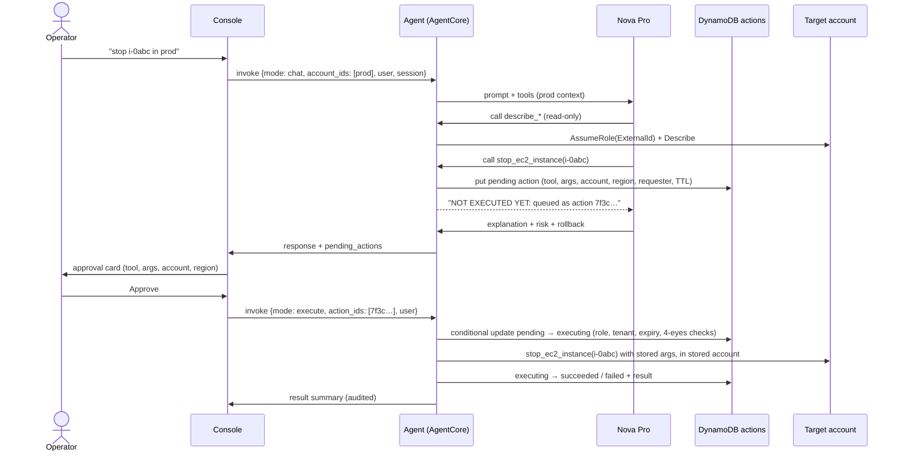

# Architecture


The diagram is generated from [`architecture.py`](architecture.py). Regenerate
it with `python docs/architecture.py`, which needs Graphviz.

## Components

| Component | Runs on | Code | Responsibility |
|---|---|---|---|
| Console | ECS Fargate behind ALB + CloudFront | `ui/` | Sign-in (Cognito OIDC), chat, account and region targeting, code upload, approval cards, tickets, account registry, audit log |
| Gateway | Inside the console process | `src/agents/gateway.py` | Calls the agent (`InvokeAgentRuntime`); falls back to the knowledge base when the agent escalates; rejects actions and lists pending ones |
| Agent | Bedrock AgentCore Runtime (Python 3.12, code deployment) | `agent_main.py`, `src/agentcore_entrypoint.py` | Routes each prompt to 1–2 tool domains, runs a Strands agent per target account, queues changes, and executes approved ones |
| Domain router | Inside the agent | `src/agents/router.py` | One Nova Micro call classifies the prompt into domains (compute, storage, network, database, security, ops, deployment) |
| Tools | Inside the agent | `src/tools/` | 285 boto3 tools; their clients are account-aware through `src/core/aws_clients.py`. Every domain also has `query_aws_api` (any read-only AWS operation, secret-returning calls blocked) and `call_aws_api` (any other AWS operation, always approval-gated), so the agent is never stuck for lack of a purpose-built tool |
| Approval engine | Inside the agent | `src/core/approvals.py` | Intercepts mutating tool calls, stores them, and executes approved ones exactly once |
| Account registry | DynamoDB `accounts` | `src/core/accounts.py` | Allow-list of accounts the agent may assume roles in |
| Learning loop | Scheduled ECS task (hourly) | `src/jobs/learning_loop.py` | Writes resolved tickets, with tenant metadata, to the knowledge bucket and starts ingestion |
| Knowledge base | Bedrock KB on S3 Vectors | `src/services/rag_service.py` | Tenant-filtered retrieval over past resolutions |

## Agent pattern

The agent follows a **router → specialist → gated tools** pattern.

1. **Route.** Nova Micro picks 1–2 of seven domains, so the model sees about
   30–60 tool schemas instead of 285. An attached code upload always adds
   `deployment`. If the reply shows a needed tool was missing, the agent retries
   once with one extra domain.
2. **Reason.** A Strands `Agent` (Nova Pro) runs with the merged tools, a
   domain prompt, and context notes. These cover the target account, the
   selected region, any uploaded artifact, and read-only mode for viewers.
3. **Act through a gate.** Read-only tools (names starting with `list_`,
   `analyze_`, `get_`, `describe_`, `check_`, `inspect_`, `search_`, `detect_`,
   `validate_`, `lookup_`, or `prepare_`) run immediately. Any other tool call
   is intercepted by `ApprovalGate`, a Strands `BeforeToolCallEvent` hook. The
   hook records the call as a pending action and cancels it, and the model is
   told the call was queued, not that it ran.
4. **Fan out.** When several accounts are targeted, the same prompt runs once
   per account inside `use_account(account)`. Every boto3 client a tool creates
   then uses that account's assumed-role credentials. Each run gets its own gate,
   so queued actions remember their account.

### Approval flow



Why it is safe:
- **No LLM in the execution step.** The stored call is replayed exactly as it
  was recorded.
- **Runs once.** A DynamoDB conditional write moves each action from
  `pending` to `executing`, so it can run only one time. Approvals expire after
  `ACTION_TTL_SECONDS` (one hour).
- **Checks on the approver.** The approver's role must be operator, SRE or
  admin, and their tenant must match. With `REQUIRE_SEPARATE_APPROVER`, the
  approver must also differ from the requester.
- **Fails closed.** If the queue write fails, the tool still does not run.
- **Prompt injection can't bypass it.** Instructions hidden in tool output can
  at most get a change *queued*, never executed.

## App builder

"Build me a URL shortener" is routed to the `build` domain. The agent:

1. Writes the code (under `src/`, standard library + AWS SDK only) and a CloudFormation template
   that takes `ArtifactBucket`/`ArtifactKey` parameters for the Lambda code location.
2. Writes the app one file per call with `prepare_app_file`, sets the template with
   `prepare_app_template`, then calls `prepare_app_bundle` (all read-only for the gate). Small,
   plain-text tool calls avoid the malformed tool calls that large JSON-in-JSON inputs provoke;
   if one still happens, the agent retries once. The bundle is validated: safe paths, size
   limits, at most 40 resources, no IAM users/access keys/Organizations/SSO/account-level
   resources, no administrator policies or `Action: "*"`. CloudFormation validates the template
   in the target account. The bundle is stored as an immutable version under
   `s3://<artifacts>/apps/<tenant>/<app_id>/v<N>/` (manifest, files, template, code.zip).
   `BUILD_MODEL_ID` (`--build-model`) can give this domain a stronger model than day-to-day
   operations use.
3. Calls `deploy_generated_app(app_id, version)`, which the gate queues. The console's approval
   card renders every file and the template from the stored version, so what you review is
   exactly what will be deployed.
4. On approval, the code zip is copied to the target account's staging bucket, the stack
   `cloudops-app-<app_id>` is created or updated (`CAPABILITY_IAM`, `CAPABILITY_AUTO_EXPAND`; never
   named IAM), and every URL output is called as a smoke test. The result includes the outputs
   and the smoke-test responses.

Changes produce a new version (`get_generated_app` loads the latest version into the draft → rewrite changed files → `prepare_app_bundle` → deploy). `delete_generated_app`
(also gated) removes the stack.

## Cross-account access

```
Agent runtime role (platform account)
   └── sts:AssumeRole + ExternalId ──► CloudOpsCrossAccountRole (each managed account)
                                          PowerUserAccess + scoped IAM, or ReadOnlyAccess
```

- Targets come from the console's picker, sent as `account_ids` on **every**
  turn, so a follow-up stays in the right account. Bare 12-digit IDs typed in
  the latest message also count. Conversation history is never scanned.
- Only accounts in the registry (plus the platform account) are used. Anything
  else is refused, with a message explaining how to register it.
- Assumed-role credentials are cached per account until 5 minutes before they
  expire.
- Uploaded code stays in the platform account's artifact bucket. The deploy
  tools read it with platform credentials, then create resources with the
  target account's credentials. EC2 instances download it through a one-hour
  presigned URL, so no cross-account bucket policy is needed.

## Data model

| Table | Key | Indexes / TTL | Contents |
|---|---|---|---|
| `<app>-actions` | `action_id` | GSI `by-session` (session_id); TTL `expires_at` | Pending, executing, succeeded, failed and rejected actions with tool, args, account, region, requester, approver, result |
| `<app>-audit` | `tenant_id`, `sk` = `<iso time>#<id>` | — (retained on delete) | Every security-relevant event, queried newest first per tenant |
| `<app>-tickets` | `ticket_id` | GSI `by-tenant` (tenant_id, created_at); sparse GSI `pending-vectorization` | Escalations and their resolutions (retained on delete) |
| `<app>-accounts` | `account_id` | — | Registered managed accounts |
| `<app>-usage` | `tenant_id`, `period` (YYYY-MM-DD) | TTL `expires_at` | Daily request counters for the per-tenant limit |

## Agent request contract

```jsonc
// chat
{"mode": "chat", "session_id": "...", "tenant_id": "...",
 "user": {"id": "...", "email": "...", "role": "operator"},
 "prompt": "<history + message>", "user_message": "<message>", "history": [],
 "account_ids": ["111122223333"], "region": "eu-west-1",
 "artifact": {"uri": "s3://.../app.zip", "filename": "app.zip", "target": "lambda", "options": {}}}
// → {"response", "domain", "accounts", "per_account", "pending_actions", "escalate", "tools_available", "execution_time_ms"}

// execute approved actions
{"mode": "execute", "action_ids": ["7f3c..."], "tenant_id": "...", "user": {...}}
// → {"response", "results": [{"action_id", "summary", "account_id", "region", "status", "result" | "error"}]}

// admin: verify a managed account's role
{"mode": "check_account", "account_id": "111122223333", "user": {"role": "admin", ...}}
```

Only the console's task role is allowed to invoke the runtime (IAM). The
console vouches for `user` from the signed Cognito session.

## Design decisions

| Decision | Why |
|---|---|
| AgentCore code deployment (S3 zip, Python 3.12) instead of a container | No image build for the agent; `deploy.py` installs Linux ARM64 wheels locally on any operating system |
| One Streamlit console with pages instead of two apps | A single service, a single sign-in, and pages chosen by role |
| Streamlit `st.login` with Cognito | Hosted sign-in, MFA and password reset without custom auth code |
| CloudFront in front of a CloudFront-only ALB | HTTPS without owning a domain, WAF, and an origin protected by both prefix list and secret header |
| Metrics as CloudWatch EMF log lines | No extra API calls on the request path |
| Approval gate as a Strands hook | Enforced in code for every tool, whatever the prompt says |
| Learning loop as a scheduled ECS task reusing the console image | No extra package to build |
