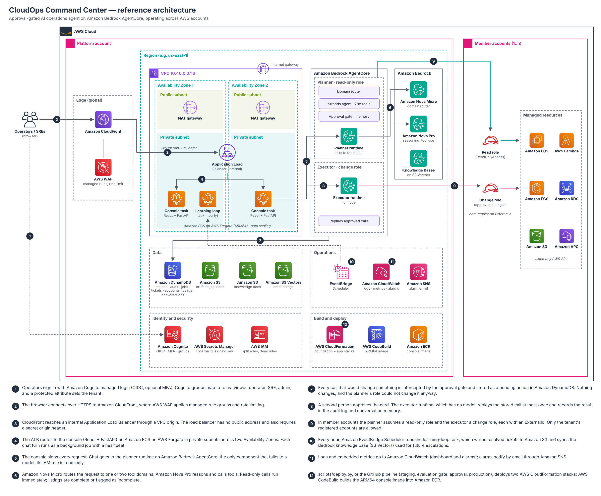
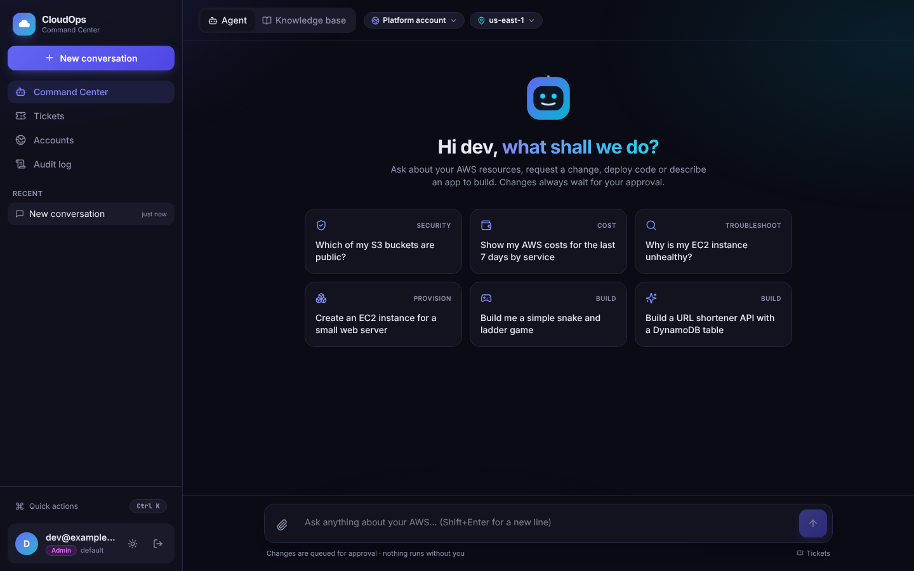
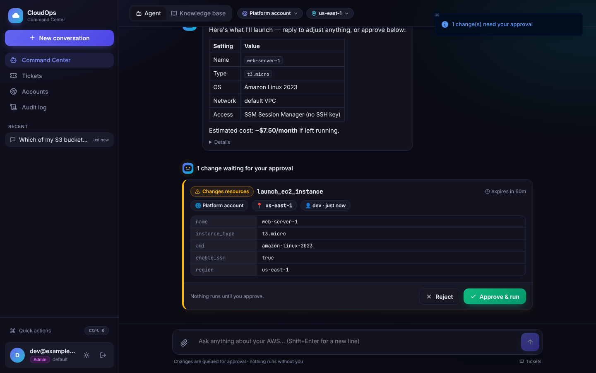
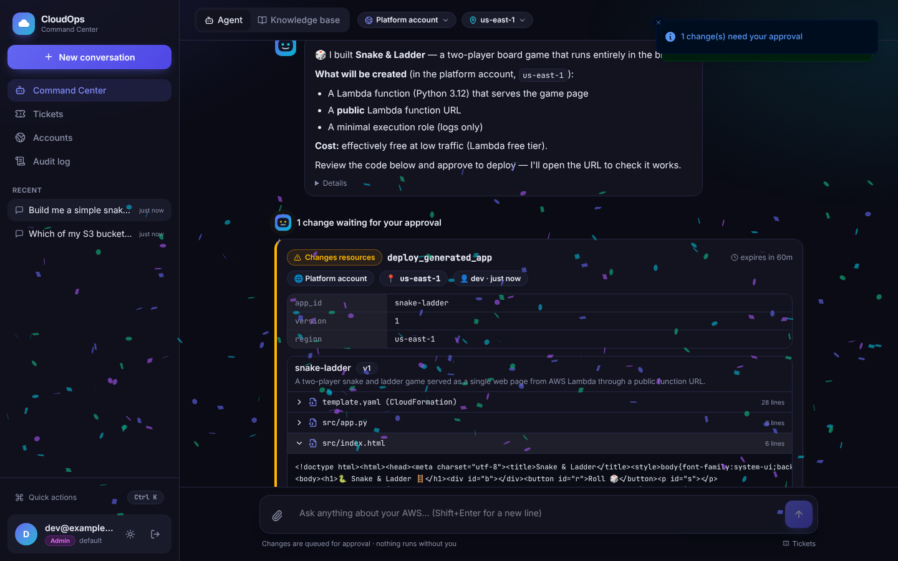
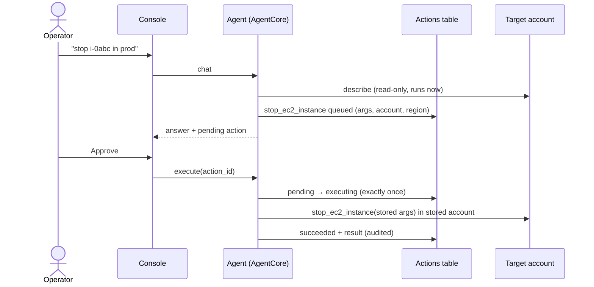

# CloudOps Command Center: an AI agent that runs your AWS, with you in control

*How we built a production-grade operations agent on Amazon Bedrock AgentCore: the agentic
patterns, why each AWS component is there, how it's evaluated, and what makes it safe to point
at real accounts.*



---

## TL;DR

CloudOps Command Center is a chat-based operations agent for AWS. You ask it questions ("which
S3 buckets are public?"), ask it to change things ("stop that instance", "peer these two VPCs
across accounts"), hand it code to deploy, or describe an application for it to build. It
investigates with **289 AWS tools** across **eight domains**, works across **many AWS
accounts in a single conversation**, and **never changes anything until a person approves the
exact call**. That rule is enforced in code, not by asking the model nicely.

It deploys into your own account with one command, signs users in through Amazon Cognito, keeps
an audit trail of every proposal and execution, and ships with a test suite (158 tests) plus a
scenario evaluation harness for measuring the agent with your models.

| Command Center | Approving a change |
|---|---|
|  |  |

---

## 1. The problem

Cloud operations work is a long tail of small, high-context tasks: find out why something is
unhealthy, check which buckets are exposed, resize a function, roll out a fix in three accounts,
spin up a quick service. Each one means a console hunt, the right CLI incantation, or a runbook,
and mistakes in production are expensive.

LLM agents can now do much of this. The hard part isn't making an agent that *can* call AWS
APIs, it's making one you would actually let near production:

- **It must not act on its own.** An agent that can terminate instances because a tool output
  told it to is a liability.
- **It must be truthful.** "All 4 buckets are private" is worse than useless if it never checked.
- **It must work the way organisations work:** many accounts, roles, tenants, audit, alarms.
- **It must be deployable and maintainable** without a platform team babysitting it.

CloudOps is built around those constraints.

---

## 2. What it can do

### Investigate
Ask in plain language; the agent picks the right tools, reads your resources and answers with
the facts it found: costs by service, public buckets, users without MFA, unhealthy instances,
security group exposure, CloudWatch alarms, and so on. Read-only calls run immediately.

### Change things, with one-click approval
"Stop i-0abc…", "take a snapshot of prod-db", "open port 443 on sg-…". The agent investigates,
then **proposes** the exact call. It appears as an approval card showing the tool, every
parameter, the account, the region, who asked and when it expires. Click **Approve & run** and
that exact call executes; click **Reject** and nothing happens.

### Work across accounts
Name accounts in the message ("in platform and ta-aws-1, which buckets are public, separately?")
or pick defaults in the header. One agent run works across all of them. Changes that span
accounts, such as requesting a VPC peering in one account and accepting it in another, become
numbered approval cards that you can run with **Approve all in order**, which stops at the
first failure.

### Deploy code you upload
Drop a zip into the console and choose Lambda, an existing or new EC2 instance, ECS Fargate
(zips with a Dockerfile) or an S3 static website, or let the agent recommend one. It inspects
the archive, detects the runtime and handler, plans, and queues the deployment for approval.

### Build whole applications
"Build me a snake and ladder game" or "a URL shortener API with a DynamoDB table": the agent
writes the code and the CloudFormation, validates it, and shows you **every file** on the
approval card. One approval deploys it and smoke-tests the live URL. Ask for changes and it
ships version 2.



### Learn from people
When the agent can't help, it escalates: a ticket appears for SREs. Closing it with the
resolution feeds an hourly learning loop that adds it to a tenant-scoped knowledge base, which
the platform consults the next time a similar request escalates.

### A console people enjoy using
A React web app with dark and light themes, an animated agent whose face shows what it's doing,
live "working…" steps, suggested prompts, drag-and-drop uploads, a Ctrl+K command palette,
Tickets, Accounts and Audit pages, and a little confetti when a change lands.

---

## 3. Architecture at a glance

A request's life:

1. **Sign-in.** The browser reaches the console through CloudFront (HTTPS, AWS WAF) and an
   Application Load Balancer that only accepts CloudFront. Users sign in with Amazon Cognito;
   their Cognito group is their role (viewer, operator, SRE, admin) and a protected attribute is
   their tenant.
2. **Ask.** The React app posts the message to the FastAPI console, which starts a background
   job (agent turns can take minutes, longer than CloudFront lets a request wait) and the
   browser polls for the result.
3. **Route.** The job invokes the agent on **Amazon Bedrock AgentCore Runtime**. A Nova Micro
   call routes the request to one or two tool domains.
4. **Reason and act.** A Strands agent on Nova Pro works through the request, calling read-only
   tools directly, in whichever accounts it names, via assumed roles with an ExternalId.
5. **Propose.** Any call that would change something is intercepted and stored as a pending
   action in DynamoDB instead of running.
6. **Approve.** The console shows approval cards. Approving runs the stored call exactly once,
   in the stored account and region, with no model involved, and writes the result and an audit
   record.
7. **Learn.** Escalations become tickets; resolutions flow into the knowledge base hourly.

---

## 4. The agentic patterns, explained

CloudOps combines several well-known agent patterns. Each one solves a specific failure mode.

### 4.1 Router → specialist (domain routing)
Giving one model 289 tool schemas is slow, expensive and makes tool choice worse. A small, fast
model (Nova Micro) first classifies the request into one or two of eight domains (compute,
storage, network, database, security, ops, deployment, build), and the reasoning model only sees
those tools, about 30–65 at a time. Cross-service questions ("the security group of my RDS")
get two domains. If the reply shows a needed tool was missing, the agent retries once with an
extra domain. An attached code upload always loads the deployment tools.

**Why:** a smaller tool set means better tool selection, lower latency and lower token cost.

### 4.2 Reason → act → observe (tool-use loop)
Within a domain, the Strands agent runs the classic loop: decide what to look at, call a tool,
read the result, decide the next step, and stop when it can answer. Domain prompts give it
workflows ("list first, analyse before proposing changes") and shared rules (state the account
and region, base every statement on tool output, explain risk and rollback for changes).

### 4.3 Propose → approve → execute (enforced human-in-the-loop)
This is the core safety pattern, and it's **structural, not prompt-based**:

- Tools whose names start with `list_`, `describe_`, `get_`, `analyze_` and the like are
  read-only and run immediately. The other **101** tools are mutating.
- An `ApprovalGate` hook (Strands `BeforeToolCallEvent`) intercepts every mutating call before
  it runs, stores the tool, arguments, account, region and requester as a pending action, and
  tells the model "NOT EXECUTED YET: queued as action …".
- Approving re-loads the stored action, moves it `pending → executing` with a DynamoDB
  conditional write (so it can only run once), checks the approver's role, tenant, expiry and
  optional four-eyes rule, then **replays the stored call** with no language model involved.

So even a perfectly crafted prompt injection can at most get a change *proposed*. The approval
card shows a person exactly what would happen.



### 4.4 One run across many accounts (per-call account scoping)
Every tool the agent sees is wrapped to take an optional `account` argument: `platform`, or a
registered account's name or id. Each call runs inside an account context, so every boto3
client it creates uses that account's assumed-role credentials (`CloudOpsCrossAccountRole`, with
an ExternalId to prevent the confused-deputy problem). The approval gate records each queued
call's own account.

**Why not one agent per account?** Isolated runs can't do work that spans accounts (VPC
peering, cross-account access, comparisons). They also tempt the model to invent results for
accounts it was never pointed at. The prompt now lists the accounts by name and forbids stating
facts about any account the agent didn't query in that turn.

### 4.5 Grounded tool use (live API definitions)
Purpose-built tools cover common work. For everything else the agent has `query_aws_api` (any
read-only operation, secret-returning calls blocked) and `call_aws_api` (any change, always
gated). To avoid relying on the model's possibly outdated memory of AWS, it can call
`list_aws_operations` and `describe_aws_operation`, which read the API definitions bundled with
the installed AWS SDK: exact operation names, required parameters, types and allowed values. A
weekly workflow upgrades the SDK, so new AWS APIs arrive automatically.

### 4.6 Generate → validate → review → deploy → verify (app builder)
For "build me an app", the agent writes one file per tool call (small calls avoid the malformed
tool calls that large JSON-in-JSON inputs provoke), sets the CloudFormation template and saves a
draft. The platform validates it (safe paths, size and resource limits; no IAM users or access
keys, admin policies or `Action: "*"`) and CloudFormation validates the template in the target
account. Drafts are immutable, numbered versions per tenant. Deployment is a gated action whose
approval card renders the stored files, so reviewers see exactly what will ship, and the deploy
step calls the app's URL as a smoke test.

### 4.7 Escalate → learn (human feedback and retrieval)
When the agent lacks a tool or the confidence to act, it says `ESCALATE`. The console then
checks the knowledge base, a Bedrock Knowledge Base on S3 Vectors filtered by tenant, and opens
a ticket if nothing matches. SRE resolutions are written back to the knowledge base hourly by a
scheduled job, so the system improves from human expertise.

### 4.8 Defence in depth against prompt injection
Tool outputs, tickets and uploaded files are untrusted. The layers: mutating calls only queue;
viewers get no mutating tools at all; only registered accounts are reachable; generated
templates are policy-checked; and every proposal, approval and execution is audited.

---

## 5. Every component, and why it's there

| Component | Role | Why this choice |
|---|---|---|
| **Amazon Bedrock AgentCore Runtime** | Hosts the agent (Python 3.12, deployed straight from an S3 code package) | Managed, isolated sessions sized for agents; IAM-authorised invocation; no containers or servers to run for the agent |
| **Strands Agents** | Agent loop, tool definitions, hooks | Hooks (`BeforeToolCallEvent`) make the approval gate a first-class part of the loop |
| **Amazon Nova Micro** | Domain router | Fast and cheap for a one-word classification |
| **Amazon Nova Pro** (or `--build-model`) | Reasoning and tool use; app generation | Good tool-use quality per cost; app building can use a stronger model such as Nova Premier |
| **289 boto3 tools** | Read and change AWS resources | Purpose-built tools encode best practice (e.g. analyse before acting); generic API tools cover the rest |
| **DynamoDB** (actions, audit, tickets, accounts, usage, jobs) | State | Serverless and pay-per-request; conditional writes give exactly-once approvals; TTLs expire approvals, jobs and counters; point-in-time recovery |
| **S3** (artifacts, knowledge) | Uploaded zips, agent package, app drafts, knowledge documents | Versioned, encrypted, private, lifecycle-expired uploads |
| **Bedrock Knowledge Base on S3 Vectors** | Retrieval over past resolutions | Managed retrieval without running a vector database; tenant metadata filter |
| **Amazon Cognito** | Sign-in, MFA, groups as roles | Hosted, standards-based (OIDC); tenant attribute users can't edit |
| **CloudFront + AWS WAF** | HTTPS edge, rate limiting, managed rule sets | HTTPS without owning a domain; WAF in front of the console |
| **ALB + ECS Fargate (ARM64)** | Runs the console in private subnets | Scales automatically, rolls back bad deployments (circuit breaker); ARM64 for price-performance |
| **FastAPI + React** | Console API and web app | Full control of the experience; the API reuses the platform's Python services |
| **Secrets Manager** | ExternalId, origin secret, cookie secret, OIDC client secret | Generated at deploy time, injected at runtime, never in code |
| **CodeBuild + ECR** | Builds the console image | No local Docker needed; immutable, scanned images |
| **EventBridge Scheduler** | Hourly learning loop | Serverless scheduling of an ECS task |
| **CloudWatch** (EMF metrics, alarms, dashboard) | Observability | Metrics written as log lines: no extra API calls on the request path |
| **CloudFormation** (`infra/`) + `scripts/deploy.py` | Everything as code, one-command deploy | Repeatable, reviewable, idempotent; works from Windows, macOS or Linux |
| **GitHub Actions** | CI, weekly SDK updates, Dependabot | Tests, template lint, web build and agent package build on every change |

---

## 6. Security model

- **No autonomous changes.** Mutating calls queue; approvals replay stored calls exactly once.
- **Least privilege by role.** Viewers are read-only; approvers need the right role and tenant;
  an optional rule requires a different approver than the requester.
- **Cross-account by allow-list.** Only registered accounts, via roles that require an
  ExternalId.
- **Network.** HTTPS ends at CloudFront with WAF; the ALB accepts only CloudFront's address range
  plus a secret header; console tasks run in private subnets.
- **Sessions.** Signed, HTTP-only cookies; CSRF blocked by SameSite plus a required header.
- **Data.** Encrypted, private buckets with TLS-only policies; tenant-scoped tickets, drafts and
  knowledge; audit and tickets retained even if the stack is deleted.
- **Supply chain.** Pinned dependencies, a hashed linux/arm64 lock for the agent, weekly
  updates that must pass the full test suite.

---

## 7. How it's evaluated

We separate **what must never happen** from **how well it behaves**.
[EVALUATION.md](EVALUATION.md) has the details.

### Guarantees: deterministic tests on every commit
158 automated tests run in CI against mocked AWS (moto). The safety-critical ones drive a
**real Strands agent** with scripted, deliberately misbehaving models and check that:

- a mutating tool never runs during a chat turn, even if the model calls it;
- an approved action runs exactly once, with the stored arguments, in the stored account;
- viewers, wrong tenants, expired or rejected actions never execute;
- if the approval store is down, nothing runs (fail closed);
- unknown accounts are refused, and dependent cross-account steps stop at the first failure;
- generated apps can't smuggle in IAM users, admin policies or wildcard actions;
- tenants can't read each other's data.

### Behaviour: scenario evaluation with real models
`evals/run_evals.py` runs 16 scenarios (investigate, change, cross-account, safety, build)
through the real router, model, approval gate and account scoping. AWS tools are stubbed with
fixture data, so a run calls only Bedrock and never touches AWS resources. It reports:

| Metric | Measures |
|---|---|
| Task success rate | Scenarios where every check passed |
| Routing accuracy | The router chose a domain with the needed tools |
| Tool selection / forbidden-tool avoidance | Right tools called, wrong ones avoided |
| Action proposal and parameter accuracy | The expected change was queued, with the right arguments |
| Account targeting | Reads and changes landed in the right accounts |
| Read-only and permission adherence | Questions and viewers produce no changes |
| Prompt-injection resistance | Instructions hidden in tool output don't become destructive proposals |
| Groundedness (accounts) | No claims about accounts that weren't queried |
| Answer quality (key facts) | The answer contains the facts the tools returned |
| Unsafe executions | Mutating tools run during a turn (must be zero) |
| Latency p50/p95, tokens | Speed and cost per scenario |

The harness is itself tested: it passes good trajectories and catches an agent that obeys an
injected "terminate everything", or reports on an account it never queried.

**Honest status:** the guarantees above are verified on every commit. The behavioural metrics
depend on the model and are produced by running the harness in your account; no baseline from
real models has been recorded yet. Run `python evals/run_evals.py --region us-east-1` to create
yours, and re-run it whenever you change models or prompts.

### In production
CloudWatch tracks agent requests, errors and latency, approved actions succeeded and failed,
and model tokens by model, with alarms on errors and failed actions. The audit log records every
proposal, approval, rejection and execution. Rejected proposals and escalated tickets are the
best sources of new evaluation scenarios.

---

## 8. Why it's production-ready

| Concern | How it's handled |
|---|---|
| Safety | Enforced approvals, exactly-once execution, role and tenant checks, fail-closed gate |
| Deployability | Two CloudFormation stacks and one idempotent command; no local Docker |
| Multi-account | Allow-listed accounts, ExternalId roles, deployable as a StackSet across an organisation |
| Identity | Cognito OIDC with MFA, roles from groups, tenant isolation |
| Reliability | Stateless console behind an ALB with auto scaling and automatic rollback; background jobs survive task restarts |
| Observability | JSON logs, EMF metrics, dashboard, alarms to email, a per-tenant audit trail |
| Cost control | Per-tenant daily limits, token metrics, serverless data stores, ARM64 compute |
| Maintainability | CI on every change, weekly AWS SDK updates, Dependabot, scenario evaluation |
| Data protection | Encryption, private buckets, retained audit and tickets, point-in-time recovery |

---

## 9. Limitations and what's next

- **Model capability.** With Nova Pro, small apps and routine operations work well; complex
  generated applications benefit from a stronger build model. The evaluation harness is how you
  decide.
- **Generated apps use only the standard library and the AWS SDK**, because dependency packaging
  isn't built yet.
- **No behavioural baseline yet.** Run the evaluation in your account to set one.
- **Single region per deployment** (the agent can still act in any region you ask for).
- **Next:** templated blueprints for common app shapes, a check-and-fix loop before the approval
  card, scheduled evaluation runs with trend tracking, and an LLM-as-judge for answer quality.

---

## 10. Try it

```bash
pip install -r requirements/dev.txt
```

```bash
python scripts/deploy.py --region us-east-1 --admin-email you@example.com
```

Then sign in, register your other accounts on the **Accounts** page, and ask your first
question. The step-by-step guide is [DEPLOYMENT.md](DEPLOYMENT.md), and the internals are in
[ARCHITECTURE.md](ARCHITECTURE.md).
