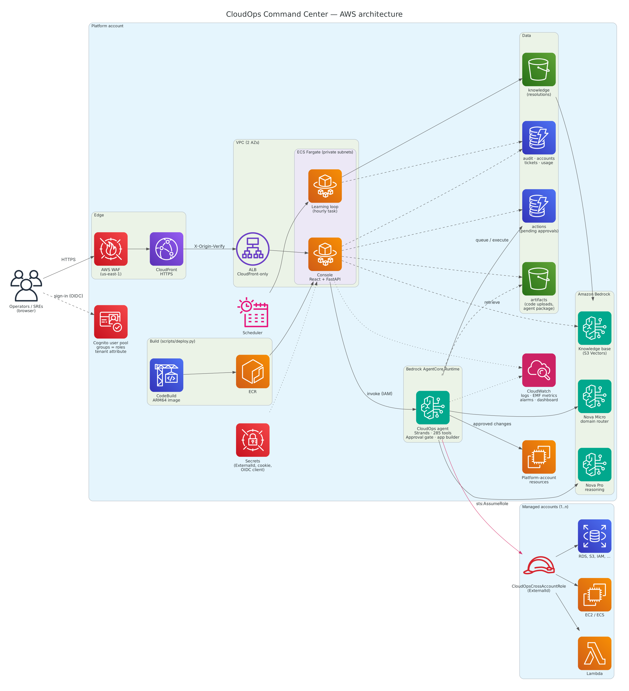

# Deploying CloudOps into your AWS account

This guide takes you from an empty AWS account to a running console that you
sign in to, with the agent able to inspect and (after your approval) change
resources in that account and in any other accounts you connect.

Everything is deployed by one command, `scripts/deploy.py`, which you can safely
re-run at any time to update the deployment.



---

## What gets deployed

| Stack | Contents |
|---|---|
| `<app>-foundation` | DynamoDB tables (tickets, audit, actions, accounts, usage), S3 buckets (artifacts, knowledge), Bedrock knowledge base on S3 Vectors, Cognito user pool with `admin`/`sre`/`operator`/`viewer` groups, generated secrets, ECR repository and a CodeBuild project that builds the console image |
| `<app>-app` | Bedrock AgentCore Runtime running the agent, VPC (2 AZs, private subnets, 1 NAT gateway), ALB, ECS Fargate console service (ARM64, auto scaling), CloudFront (HTTPS) with AWS WAF, Cognito app client, hourly learning-loop task, CloudWatch alarms and dashboard |
| `cloudops-cross-account` (per managed account) | `CloudOpsCrossAccountRole`, which the agent assumes, plus service roles used by code deployments |

`<app>` is `cloudops` unless you pass `--app-name`.

**Estimated baseline cost** is about USD 120–160 per month in us-east-1. Most
of that is the NAT gateway, the ALB, two Fargate tasks and WAF. Bedrock model
tokens and AgentCore runtime usage are billed on top, per request. Check current
pricing for your region before deploying.

---

## Prerequisites

1. **An AWS account and credentials** with administrator access, or at least
   rights to create IAM roles, VPCs, ECS, CloudFront, Cognito, Bedrock and
   AgentCore resources.
2. **A supported region.** The region must offer Bedrock AgentCore Runtime,
   Bedrock Knowledge Bases with S3 Vectors, and the Nova models.
   **`us-east-1` is recommended**, because WAF for CloudFront is only created
   there. In other regions the console works but has no WAF.
3. **Python 3.10 or newer** and `git`.
4. **Bedrock model access.** In the Bedrock console, open **Model access** and
   make sure these are available in your region:
   - Amazon Nova Pro and Amazon Nova Micro (the agent and the router)
   - Amazon Titan Text Embeddings V2 (the knowledge base)

   The default model IDs use US cross-region inference profiles
   (`us.amazon.nova-pro-v1:0`). In an EU or APAC region, pass the matching
   profile, for example `--agent-model eu.amazon.nova-pro-v1:0 --router-model eu.amazon.nova-micro-v1:0`.

You do **not** need Docker. The console image is built in CodeBuild, and the
agent is deployed as a code package.

---

## Step 1 — Get the code and install the tooling

```bash
git clone https://github.com/desai-sys/autonomous-support-desk.git
```

```bash
cd autonomous-support-desk
```

```bash
python -m venv .venv
```

Activate the virtual environment. On macOS or Linux:

```bash
source .venv/bin/activate
```

On Windows (PowerShell):

```powershell
.venv\Scripts\Activate.ps1
```

Then install the dependencies:

```bash
pip install -r requirements/dev.txt
```

## Step 2 — Point at your AWS account

Use whichever method you normally use: `aws configure`, `aws sso login --profile <name>`,
or environment variables. Then confirm which account you're in:

```bash
aws sts get-caller-identity
```

If you use a named profile, pass `--profile <name>` to the deploy script.

## Step 3 — (Optional) Validate the templates

```bash
cfn-lint infra/*.yaml
```

```bash
pytest -q
```

## Step 4 — Deploy

```bash
python scripts/deploy.py --region us-east-1 --admin-email you@example.com --alarm-email oncall@example.com
```

The first run takes roughly **25–40 minutes**, mostly creating the CloudFront
distribution. The script prints each step:

1. Foundation stack: tables, buckets, knowledge base, Cognito, secrets, image build project
2. Agent package: dependencies installed as Linux ARM64 wheels and zipped with the source (about 30 MB), then uploaded to S3
3. Console image: built by CodeBuild and pushed to ECR
4. App stack: AgentCore runtime, network, console service, CloudFront, schedule, alarms
5. Admin invite: Cognito emails `you@example.com` a temporary password

When it finishes it prints the console URL (`https://dxxxxxxxx.cloudfront.net`)
and the values you need for Step 6.

Useful options (run `python scripts/deploy.py --help` for all of them):

| Option | Default | Meaning |
|---|---|---|
| `--platform-access PowerUser\|ReadOnly` | `PowerUser` | What approved changes may do in this account. `ReadOnly` makes the agent inspect-only here. |
| `--require-separate-approver` | off | The person who requested a change cannot approve it (four-eyes principle). |
| `--daily-request-limit N` | `0` (unlimited) | Agent requests per tenant per day. |
| `--console-tasks N` | `2` | Minimum number of console tasks. Auto scaling goes up to 6. |
| `--domain`, `--certificate-arn` | none | Serve the console on your own domain (see Step 8). |
| `--build-model` | same as `--agent-model` | Model for the app builder (writing whole applications). A stronger model such as `us.amazon.nova-premier-v1:0` produces better code. |
| `--app-name` | `cloudops` | Deploy several independent copies side by side. |
| `--environment` | `prod` | Label used in metrics and the UI. |

## Step 5 — Sign in

1. Open the console URL and click **Sign in**. This takes you to the Cognito
   sign-in page.
2. Sign in with your email and the temporary password from the invitation email,
   then choose a new password (at least 12 characters, mixed case, a number and a
   symbol).
3. Optional but recommended: set up MFA (TOTP) when prompted, or from the
   Cognito-hosted page later.

**Adding more users.** Each user's role comes from their Cognito group, and
their tenant from the `custom:tenant_id` attribute:

```bash
aws cognito-idp admin-create-user --user-pool-id <UserPoolId> --username alice@example.com --user-attributes Name=email,Value=alice@example.com Name=email_verified,Value=true Name=custom:tenant_id,Value=default
```

```bash
aws cognito-idp admin-add-user-to-group --user-pool-id <UserPoolId> --username alice@example.com --group-name operator
```

`<UserPoolId>` is the `UserPoolId` output of the `<app>-foundation` stack.

| Group | Can |
|---|---|
| `viewer` | Chat with the agent in read-only mode (no mutating tools are loaded), search the knowledge base, see tickets |
| `operator` | Everything above, plus have the agent propose changes, approve or reject them, and upload code |
| `sre` | Everything above, plus resolve tickets, view the audit log, and run the knowledge sync |
| `admin` | Everything, including registering managed accounts |

## Step 6 — Connect your other AWS accounts (cross-account)

The agent acts on the platform account by default. To let it work in other
accounts, do the following for each one.

**6a. Get the two values the target role needs.** Both are printed by
`deploy.py` and shown on the console's **Accounts** page:

```bash
aws cloudformation describe-stacks --stack-name cloudops-app --query "Stacks[0].Outputs[?OutputKey=='AgentRuntimeRoleArn'].OutputValue" --output text
```

```bash
aws secretsmanager get-secret-value --secret-id cloudops/cross-account-external-id --query SecretString --output text
```

**6b. Deploy the role in the target account.** Use credentials for *that*
account:

```bash
aws cloudformation deploy --template-file infra/cross_account_role.yaml --stack-name cloudops-cross-account --capabilities CAPABILITY_NAMED_IAM --parameter-overrides AgentRuntimeRoleArn=<role-arn> ExternalId=<external-id> AccessLevel=PowerUser
```

Use `AccessLevel=ReadOnly` for accounts the agent should only inspect.

**To connect many accounts at once**, deploy the same template as a
CloudFormation StackSet from your AWS Organizations management account (or a
delegated administrator), targeting the organizational units you want. Use the
service-managed permission model and turn on automatic deployment, so new
accounts get the role too.

**6c. Register the account.** On the console's **Accounts** page, enter the
account ID and a name, click **Add**, then **Test access**. You should see
"Connected to <id> as arn:aws:sts::<id>:assumed-role/CloudOpsCrossAccountRole/…".

The agent only assumes roles in registered accounts. Requests that name any
other account are refused.

## Step 7 — Use it

1. **Command Center → Target accounts.** Pick one or more accounts (leave it
   empty for the platform account) and a region.
2. Ask, for example, "which S3 buckets are public?" or "why is i-0abc… unhealthy?"
3. Ask for a change, for example "stop i-0abc…". The agent investigates, then
   queues the exact tool call. It appears as a card under **changes awaiting
   approval**, showing the tool, the arguments, the account and the region.
   Click **Approve** to run exactly that call, or **Reject** to discard it.
   Nothing changes until someone approves.
4. **Deploy code.** Open **📦 Deploy code (.zip)**, upload a zip, choose Lambda,
   EC2 (existing or new), ECS Fargate (the zip needs a Dockerfile), an S3
   website, or "let the agent recommend", and send. Approve the queued
   deployment.
5. If the agent can't help, it escalates. A ticket appears on **Tickets**. An
   SRE closes it with the resolution, and the hourly learning loop adds that
   resolution to the knowledge base, which the agent uses next time.

## Step 8 — (Optional) Custom domain

1. In **us-east-1**, request an ACM certificate for `ops.example.com` and
   complete DNS validation. CloudFront certificates must live in us-east-1,
   whatever region the stack is in.
2. Re-run the deploy script with your domain and certificate:

   ```bash
   python scripts/deploy.py --region us-east-1 --domain ops.example.com --certificate-arn arn:aws:acm:us-east-1:<account>:certificate/<id>
   ```

3. Create a DNS CNAME (or a Route 53 alias) from `ops.example.com` to the
   CloudFront domain that the script prints.

---

## Updating

Pull the new code and re-run `deploy.py` with the same options. The agent
package and console image are rebuilt only if their contents changed. ECS rolls
out new console tasks with a circuit breaker that rolls back automatically if
the new tasks fail health checks.

## Monitoring

| Where | What |
|---|---|
| CloudWatch dashboard `<app>-<env>` | Agent requests, errors and p90 latency; approved actions (succeeded/failed); console traffic and 5xx errors |
| SNS topic `<app>-alarms` (subscribed to `--alarm-email`) | Unhealthy console tasks, console 5xx errors, agent errors, failed approved actions |
| Log group `/<app>/console` | Console and learning-loop logs (JSON) |
| Log groups `/aws/bedrock-agentcore/runtimes/<app>_agent-*` | Agent logs (JSON, including every queued and executed action) |
| Console **Audit log** page / `<app>-audit` table | Logins, queries, proposed, approved, rejected and executed actions, account changes |

## Security model (summary)

- **The model can't change anything by itself.** Every mutating tool call is
  intercepted and stored as a pending action. Only an approval runs it, and it
  runs exactly once with the stored arguments, in the stored account and region.
  No language model is involved in that step. Approvals expire after an hour.
- **Identity.** Users authenticate with Cognito (OIDC, optional MFA). Their
  role comes from Cognito groups and their tenant from a user attribute they
  can't change themselves.
- **Network.** HTTPS ends at CloudFront, with AWS WAF in us-east-1. The load
  balancer only accepts CloudFront's IP ranges carrying a secret header. Console
  tasks run in private subnets.
- **Cross-account.** Access goes through a role per account that requires an
  ExternalId, and only accounts on the registry allow-list are used.
- **Data.** All buckets block public access and require TLS. Tables are
  encrypted, with point-in-time recovery. Knowledge-base retrieval is filtered
  by tenant.
- **Secrets.** These live in Secrets Manager and are injected into tasks at
  start. Nothing secret is committed to the repository.

See [ARCHITECTURE.md](ARCHITECTURE.md) for the full design.

## Removing everything

```bash
python scripts/destroy.py --region us-east-1
```

The tickets and audit tables are kept unless you add `--delete-data`. Remove
the `cloudops-cross-account` stack (or StackSet) from each managed account
separately. Resources the agent created for you, such as Lambda functions or
instances, are not touched.

## Troubleshooting

| Symptom | Fix |
|---|---|
| `Change set ... failed` on the first run | Read the reason printed. Usually a missing permission or a region without AgentCore, S3 Vectors or the Nova models. |
| App stack fails on `AgentRuntime` | Check that AgentCore Runtime is available in the region and the package uploaded (`s3://<artifacts>/agent/agent-*.zip`). The stack events show the service's error message. |
| `AccessDeniedException` when chatting | Bedrock model access is missing, or the model ID doesn't exist in the region. Pass `--agent-model` and `--router-model` with the right inference profiles. |
| Sign-in loops or shows `redirect_mismatch` | You changed `--domain`. Re-run `deploy.py` so the Cognito callback URL and the console agree. |
| "Account … is not registered" | Add it on the Accounts page. |
| "Cannot assume CloudOpsCrossAccountRole" | Deploy `infra/cross_account_role.yaml` in that account with the current runtime role ARN and ExternalId. |
| Console shows 403 Forbidden | You reached the load balancer directly. Always use the CloudFront URL. |
| Console image build fails | Open the CodeBuild log link the script prints. |

---

## Local development

Run the agent and the console on your machine against a deployed stack's
tables, or against moto.

Start the agent:

```bash
python agent_main.py
```

Then, in another terminal, start the console with the development sign-in:

```bash
AUTH_MODE=local AGENT_ENDPOINT_URL=http://localhost:8080 uvicorn console.server:app --port 8090
```

Build the web app once so the console server can serve it:

```bash
cd web && npm ci && npm run build
```

Then open http://localhost:8090. To work on the frontend with instant reloads, run the Vite dev
server instead (it proxies the API to the console on port 8090) and open http://localhost:5173:

```bash
cd web && npm run dev
```

Set the table, bucket and knowledge-base environment variables from
[`config.py`](../config.py) to the deployed stacks' outputs, or point
`AWS_ENDPOINT_URL` at a moto server. Never set `AUTH_MODE=local` on a deployed
stack.
